# Manual Técnico: Proyecto Conectividad XXI - Integración de Operadores Nacionales

**Curso:** Redes de Computadoras 2 - Segundo Semestre 2026</br>
**Estudiante:** David Andrés Jimenez Paniagua </br>
**Carné:** 202004777 </br>
**Dominio configurado:** `www.proyecto2_202004777.com` </br>
**Archivo de simulación:** `Proyecto2_202004777.pkt` (Cisco Packet Tracer) </br>

<div align="center">

    

</div>

---

## Resumen de la solución

Se diseñó una infraestructura nacional de telecomunicaciones con tres ISPs interconectados por BGP. Cada ISP tiene una topología, un protocolo de enrutamiento interno y servicios propios:

| | FibraNet GT | AndinaCom | MoonLink |
| :---: | :---: | :---: | :---: |
| **AS BGP** | 65017 | 65027 | 65032 |
| **Topología** | Árbol | Jerárquica (3 capas) | Hub-and-spoke |
| **IGP** | OSPF (área 0) | OSPF (área 0) | EIGRP (AS 100) |
| **Departamentos** | Administración, Atención al Cliente | Ventas, Facturación | Soporte, Seguridad (+ red WiFi) |
| **Red asignada** | 172.16.17.0/24 | 172.16.27.0/24 | 172.16.32.0/24 |
| **Servicio central** | DNS + HTTP/HTTPS | DHCP + HSRP | Red inalámbrica |
| **EtherChannel LACP** | 2 (ADM y ATC) | 2 (Po1 y Po2) | 2 (SOP y SEG) |

**Topología de interconexión (triángulo BGP, enlaces de fibra):**

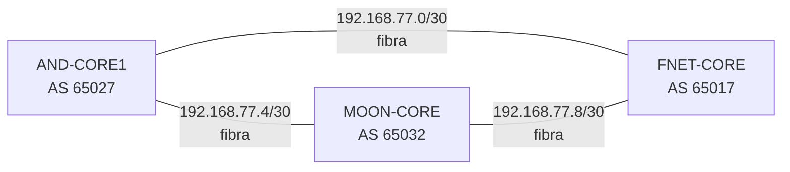

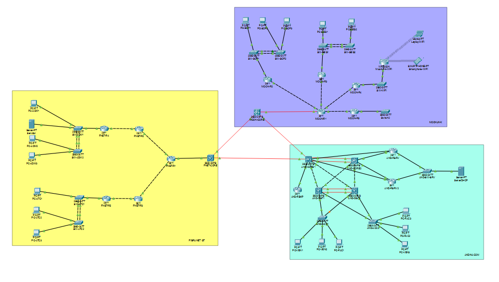

---

## Direccionamiento general y BGP

### Redes asignadas

Carnet utilizado: `202004777`

| Elemento | Red | Origen |
| :---: | :---: | :---: |
| Interconexión y enlaces entre routers | `192.168.77.0` | Últimos 2 dígitos del carné (77) |
| FibraNet GT | `172.16.17.0/24` | `172.16.1X`, X = último dígito (7) |
| AndinaCom | `172.16.27.0/24` | `172.16.2X`, X = último dígito (7) |
| MoonLink | `172.16.32.0/24` | `172.16.3X`, X = primer dígito (2) |

El enunciado asigna `192.168.XX.0/16`. Con ese prefijo el 77 cae en los bits de host, así que `192.168.77.0/16` equivale a `192.168.0.0/16`. Se trabajó dentro de `192.168.77.0` aplicando VLSM (/30 para enlaces punto a punto) y se tomó como decisión de diseño.

### Distribución de `192.168.77.0`

| Bloque | Uso |
| :---: | :---: |
| 192.168.77.0 - .11 | Enlaces BGP entre ISPs (3 × /30) |
| 192.168.77.32/27 | Enlaces internos de FibraNet |
| 192.168.77.64/27 | Enlaces internos de AndinaCom (capa core, distribución y servicios) |
| 192.168.77.96/27 | Enlaces internos de MoonLink |
| 192.168.77.128/27 | Enlaces de AndinaCom hacia los routers de servicios adicionales |

### Enlaces BGP (fibra, transceptor GLC-LH-SMD)

| Enlace | Puertos | Red | Lado A | Lado B |
| :---: | :---: | :---: | :---: | :---: |
| FibraNet ↔ AndinaCom | FNET-CORE Gi1/1/1 ↔ AND-CORE1 Gi1/1/3 | 192.168.77.0/30 | .1 | .2 |
| AndinaCom ↔ MoonLink | AND-CORE1 Gi1/1/4 ↔ MOON-CORE Gi1/1/1 | 192.168.77.4/30 | .5 | .6 |
| MoonLink ↔ FibraNet | MOON-CORE Gi1/1/2 ↔ FNET-CORE Gi1/1/2 | 192.168.77.8/30 | .9 | .10 |

### Configuración BGP

| ISP | Dispositivo | AS | Router ID | Vecinos | Red anunciada |
| :---: | :---: | :---: | :---: | :---: | :---: |
| FibraNet | FNET-CORE | 65017 | 1.1.1.1 | 192.168.77.2 (AS 65027), 192.168.77.9 (AS 65032) | 172.16.17.0/24 |
| AndinaCom | AND-CORE1 | 65027 | 2.2.2.2 | 192.168.77.1 (AS 65017), 192.168.77.6 (AS 65032) | 172.16.27.0/24 |
| MoonLink | MOON-CORE | 65032 | 3.3.3.1 | 192.168.77.5 (AS 65027), 192.168.77.10 (AS 65017) | 172.16.32.0/24 |

Cada ISP crea una ruta estática a `Null0` para su `/24` completo, porque el comando `network` de BGP solo anuncia prefijos que existan exactamente en la tabla de enrutamiento.

### Redistribución hacia el IGP

Los routers internos necesitan conocer los prefijos de los otros ISPs. El switch multicapa de Packet Tracer no acepta `default-information originate` en OSPF, así que se redistribuye BGP dentro del IGP:

| Dispositivo | Comando |
| :---: | :---: |
| FNET-CORE | `router ospf 1` -> `redistribute bgp 65017 subnets` |
| AND-CORE1 | `router ospf 1` -> `redistribute bgp 65027 subnets` |
| MOON-CORE | `router eigrp 100` -> `redistribute bgp 65032 metric 100000 100 255 1 1500` |

En EIGRP la métrica es obligatoria al redistribuir. Sin ella los routers internos no aprenden las rutas.

- **AND-CORE1**
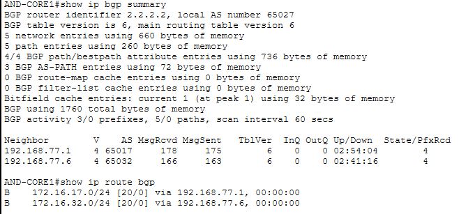

- **FNET-CORE**
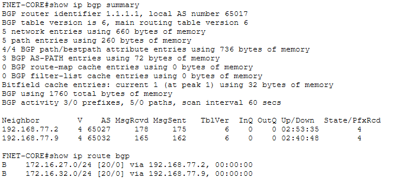

- **MOON-CORE**
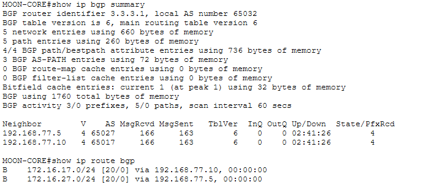

---

## ISP 1: FibraNet GT

- **Topología:** árbol (una raíz, dos ramas, sin lazos).
- **IGP:** OSPF proceso 1, área 0.
- **Servicios:** HTTP/HTTPS para toda la topología.
- **Dispositivos:** FNET-CORE (switch multicapa 3650, borde BGP), 5 routers 2911 (FNET-R1 a FNET-R5), 4 switches 2960 y 6 hosts más el servidor.

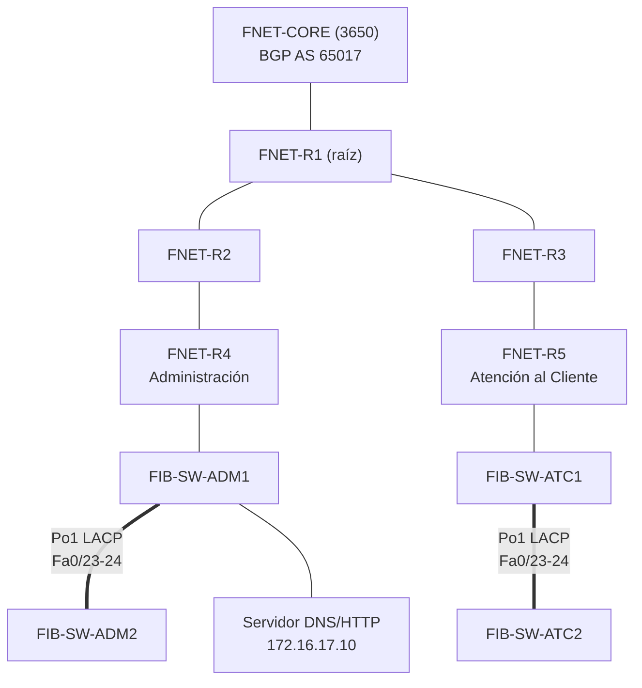

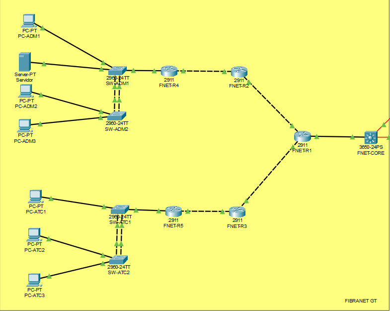

### Subneteo

La red `172.16.17.0/24` se divide en dos /25, porque cada departamento debe soportar hasta 75 hosts (un /25 ofrece 126 útiles).

| Departamento | Red | Máscara | Gateway | Rango útil | Broadcast |
| :---: | :---: | :---: | :---: | :---: | :---: |
| Administración (+ servidor) | 172.16.17.0/25 | 255.255.255.128 | 172.16.17.1 | .1 – .126 | 172.16.17.127 |
| Atención al Cliente | 172.16.17.128/25 | 255.255.255.128 | 172.16.17.129 | .129 – .254 | 172.16.17.255 |

Los enlaces entre routers usan `192.168.77.32/27`, porque los dos /25 consumen todo el `/24` asignado.

### Direccionamiento de enlaces

| Enlace | Medio | Red | Lado A | Lado B |
| :---: | :---: | :---: | :---: | :---: |
| FNET-CORE Gi1/0/1 ↔ R1 Gi0/0 | Cobre | 192.168.77.32/30 | .33 | .34 |
| FNET-R1 Gi0/1 ↔ FNET-R2 Gi0/0 | Cobre | 192.168.77.36/30 | .37 | .38 |
| FNET-R1 Gi0/2 ↔ FNET-R3 Gi0/0 | Cobre | 192.168.77.40/30 | .41 | .42 |
| FNET-R2 Gi0/1 ↔ FNET-R4 Gi0/0 | Cobre | 192.168.77.44/30 | .45 | .46 |
| FNET-R3 Gi0/1 ↔ FNET-R5 Gi0/0 | Cobre | 192.168.77.48/30 | .49 | .50 |
| FNET-R4 Gi0/1 ↔ FIB-SW-ADM1 Gi0/1 | Cobre | 172.16.17.0/25 | .1 | - |
| FNET-R5 Gi0/1 ↔ FIB-SW-ATC1 Gi0/1 | Cobre | 172.16.17.128/25 | .129 | - |

Router IDs:

- FNET-CORE 1.1.1.1
- FNET-R1 1.1.1.2
- FNET-R2 1.1.1.3
- FNET-R3 1.1.1.4
- FNET-R4 1.1.1.5
- FNET-R5 1.1.1.6.

### EtherChannels LACP

| Par de switches | Puertos | Grupo |
| :---: | :---: | :---: |
| FIB-SW-ADM1 ↔ FIB-SW-ADM2 | Fa0/23 y Fa0/24 en ambos | Po1 (LACP) |
| FIB-SW-ATC1 ↔ FIB-SW-ATC2 | Fa0/23 y Fa0/24 en ambos | Po1 (LACP) |

Los uplinks hacia el router usan `Gi0/1` (1 Gbps), de modo que la salida del departamento no sea el cuello de botella. El LACP usa puertos Fast Ethernet para dejar el Gigabit al uplink.

### Hosts

| Dispositivo | Switch | Departamento | Dirección |
| :---: | :---: | :---: | :---: |
| Servidor DNS/HTTP | FIB-SW-ADM1 Fa0/2 | Administración | 172.16.17.10 (estática) |
| PC-ADM1 | FIB-SW-ADM1 Fa0/1 | Administración | DHCP |
| PC-ADM2 | FIB-SW-ADM2 Fa0/1 | Administración | DHCP |
| PC-ADM3 | FIB-SW-ADM2 Fa0/2 | Administración | DHCP |
| PC-ATC1 | FIB-SW-ATC1 Fa0/1 | Atención al Cliente | DHCP |
| PC-ATC2 | FIB-SW-ATC2 Fa0/1 | Atención al Cliente | DHCP |
| PC-ATC3 | FIB-SW-ATC2 Fa0/2 | Atención al Cliente | DHCP |

### Configuración

Para el Switch de capa 3 **FNET-CORE (3650, borde BGP)**

```cisco
enable
configure terminal
hostname FNET-CORE
no ip domain-lookup
ip routing
interface gigabitEthernet 1/0/1
 description A-FNET-R1
 no switchport
 ip address 192.168.77.33 255.255.255.252
 no shutdown
interface gigabitEthernet 1/1/1
 description FIBRA-BGP-ANDINACOM
 no switchport
 ip address 192.168.77.1 255.255.255.252
 no shutdown
interface gigabitEthernet 1/1/2
 description FIBRA-BGP-MOONLINK
 no switchport
 ip address 192.168.77.10 255.255.255.252
 no shutdown
ip route 172.16.17.0 255.255.255.0 null0
router ospf 1
 router-id 1.1.1.1
 network 192.168.77.32 0.0.0.31 area 0
 redistribute bgp 65017 subnets
router bgp 65017
 bgp router-id 1.1.1.1
 neighbor 192.168.77.2 remote-as 65027
 neighbor 192.168.77.9 remote-as 65032
 network 172.16.17.0 mask 255.255.255.0
end
write memory
```

Se adjunta el ejemplo de como se configuraron los routers, en este caso **FNET-R5 (Atención al Cliente)**

```cisco
enable
configure terminal
hostname FNET-R5
no ip domain-lookup
interface gigabitEthernet 0/0
 ip address 192.168.77.50 255.255.255.252
 no shutdown
interface gigabitEthernet 0/1
 description LAN-ATENCION
 ip address 172.16.17.129 255.255.255.128
 ip helper-address 172.16.27.130
 no shutdown
router ospf 1
 router-id 1.1.1.6
 network 192.168.77.32 0.0.0.31 area 0
 network 172.16.17.128 0.0.0.127 area 0
 passive-interface gigabitEthernet 0/1
end
write memory
```

Para la cofiguración de **Switches de acceso (2960): FIB-SW-ADM1, FIB-SW-ADM2, FIB-SW-ATC1, FIB-SW-ATC2:**

Cambia solo el `hostname`. En SW-ADM1 y SW-ATC1 el puerto `Gi0/1` hacia el router no requiere configuración (viene activo como puerto de acceso en VLAN 1).

```cisco
enable
configure terminal
hostname FIB-SW-ADM1
no ip domain-lookup
interface range fastEthernet 0/23 - 24
 channel-protocol lacp
 channel-group 1 mode active
 no shutdown
end
write memory
```

- Validación del ospf en FNET-R1
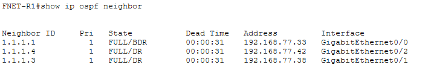

- Validación de `etherchannel` en switches `SW-ADM1` y en `SW-ADM2`.

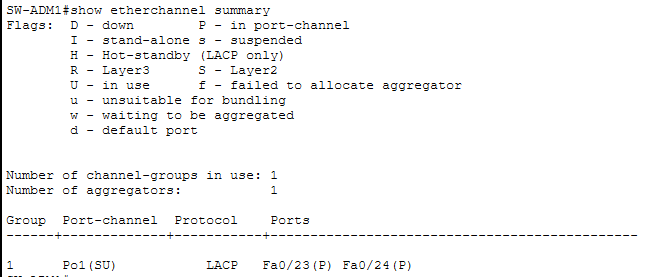

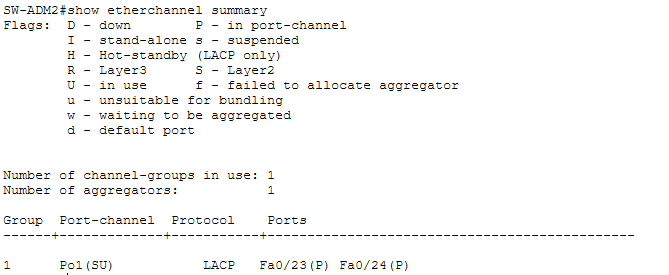

- Validación de ospf en `FNET-R4` y en `FNET-R5`

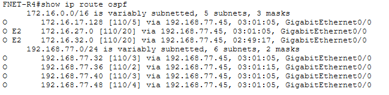

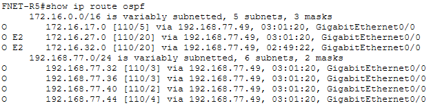

---

## ISP 2: AndinaCom

- **Topología:** jerárquica de tres capas (core, distribución, acceso) más una rama de servicios.
- **IGP:** OSPF proceso 1, área 0.
- **Redundancia de capa 3:** HSRP entre AND-DIST1 (Active, prioridad 110) y AND-DIST2 (Standby, prioridad 100), con `preempt`.
- **Servicio central:** DHCP para toda la topología, con `ip helper-address` en las SVIs y en los gateways de los otros ISPs.
- **Agregación:** dos EtherChannels LACP (Po1 entre DIST1 y DIST2, Po2 entre CORE1 y CORE2), ambos sobre fibra.

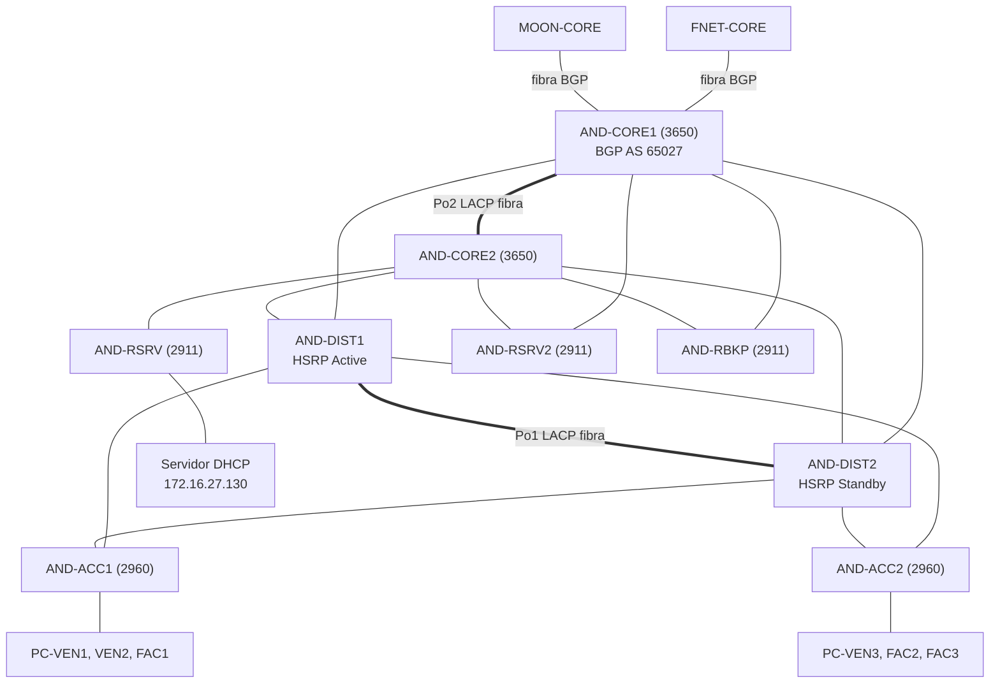

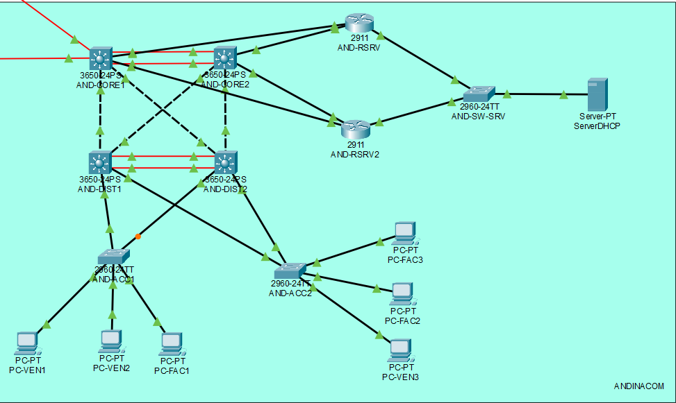

### Dispositivos

| Capa | Dispositivo | Modelo | Función | Router ID |
| :---: | :---: | :---: | :---: | :---: |
| Core | AND-CORE1 | 3650-24PS | Interconexión BGP | 2.2.2.2 |
| Core | AND-CORE2 | 3650-24PS | Core redundante | 2.2.2.3 |
| Distribución | AND-DIST1 | 3650-24PS | Gateway HSRP activo, root STP | 2.2.2.4 |
| Distribución | AND-DIST2 | 3650-24PS | Gateway HSRP standby | 2.2.2.5 |
| Servicios | AND-RSRV | Router 2911 | Gateway del servidor DHCP | 2.2.2.6 |
| Servicios | AND-RSRV2 | Router 2911 | Router de servicios redundante (doble enlace a CORE1 y CORE2) | 2.2.2.7 |
| Servicios | AND-RBKP | Router 2911 | Router de respaldo del núcleo (doble enlace a CORE1 y CORE2) | 2.2.2.8 |
| Acceso | AND-ACC1, AND-ACC2 | 2960-24TT | Conexión de hosts | - |

### Subneteo y VLANs

| VLAN | Departamento | Red | IP virtual HSRP | DIST1 | DIST2 |
| :---: | :---: | :---: | :---: | :---: | :---: |
| 10 | Ventas | 172.16.27.0/26 | 172.16.27.1 | .2 | .3 |
| 20 | Facturación | 172.16.27.64/26 | 172.16.27.65 | .66 | .67 |
| - | Servidor DHCP | 172.16.27.128/27 | - | RSRV: .129 | - |

El tamaño de las subredes queda a discreción del estudiante: dos /26 (62 hosts) para los departamentos y un /27 (30 hosts) para servicios.

Servidor DHCP: `172.16.27.130/27`, gateway `172.16.27.129`.

### Direccionamiento de enlaces

| Enlace | Medio | Red | Lado A | Lado B |
| :---: | :---: | :---: | :---: | :---: |
| CORE1 Gi1/0/1 ↔ DIST1 Gi1/0/1 | Cobre | 192.168.77.64/30 | .65 | .66 |
| CORE1 Gi1/0/2 ↔ DIST2 Gi1/0/2 | Cobre | 192.168.77.68/30 | .69 | .70 |
| CORE2 Gi1/0/2 ↔ DIST1 Gi1/0/2 | Cobre | 192.168.77.72/30 | .73 | .74 |
| CORE2 Gi1/0/1 ↔ DIST2 Gi1/0/1 | Cobre | 192.168.77.76/30 | .77 | .78 |
| CORE1 Po2 ↔ CORE2 Po2 (Gi1/1/1-2) | **Fibra** | 192.168.77.80/30 | .81 | .82 |
| CORE2 Gi1/0/3 ↔ RSRV Gi0/0 | Cobre | 192.168.77.84/30 | .85 | .86 |
| RSRV Gi0/1 ↔ Servidor DHCP | Cobre | 172.16.27.128/27 | .129 | .130 |
| CORE1 Gi1/0/3 ↔ RSRV2 Gi0/0 | Cobre | 192.168.77.128/30 | .129 | .130 |
| CORE2 Gi1/0/4 ↔ RSRV2 Gi0/1 | Cobre | 192.168.77.132/30 | .133 | .134 |
| CORE1 Gi1/0/4 ↔ RBKP Gi0/0 | Cobre | 192.168.77.136/30 | .137 | .138 |
| CORE2 Gi1/0/5 ↔ RBKP Gi0/1 | Cobre | 192.168.77.140/30 | .141 | .142 |

Enlaces de capa 2:

| Origen | Destino | Medio | Función |
| :---: | :---: | :---: | :---: |
| DIST1 Gi1/1/1-2 | DIST2 Gi1/1/1-2 | **Fibra** | Po1 (LACP, trunk) |
| DIST1 Gi1/0/3 | ACC1 Gi0/1 | Cobre | Trunk |
| DIST1 Gi1/0/4 | ACC2 Gi0/1 | Cobre | Trunk |
| DIST2 Gi1/0/3 | ACC1 Gi0/2 | Cobre | Trunk |
| DIST2 Gi1/0/4 | ACC2 Gi0/2 | Cobre | Trunk |

### Hosts

| Switch | Puerto | PC | VLAN |
| :---: | :---: | :---: | :---: |
| ACC1 | Fa0/1 | PC-VEN1 | 10 |
| ACC1 | Fa0/2 | PC-VEN2 | 10 |
| ACC1 | Fa0/3 | PC-FAC1 | 20 |
| ACC2 | Fa0/1 | PC-VEN3 | 10 |
| ACC2 | Fa0/2 | PC-FAC2 | 20 |
| ACC2 | Fa0/3 | PC-FAC3 | 20 |

### Configuración

Para el switch de capa 3 central, **AND-CORE1:**

```cisco
enable
configure terminal
hostname AND-CORE1
no ip domain-lookup
ip routing
interface loopback 0
 ip address 2.2.2.2 255.255.255.255
interface gigabitEthernet 1/0/1
 description A-DIST1
 no switchport
 ip address 192.168.77.65 255.255.255.252
 no shutdown
interface gigabitEthernet 1/0/2
 description A-DIST2
 no switchport
 ip address 192.168.77.69 255.255.255.252
 no shutdown
interface gigabitEthernet 1/0/3
 description A-RSRV2
 no switchport
 ip address 192.168.77.129 255.255.255.252
 no shutdown
interface gigabitEthernet 1/0/4
 description A-RBKP
 no switchport
 ip address 192.168.77.137 255.255.255.252
 no shutdown
interface port-channel 2
 no switchport
 ip address 192.168.77.81 255.255.255.252
interface range gigabitEthernet 1/1/1 - 2
 description FIBRA-LACP-CORE2
 no switchport
 channel-protocol lacp
 channel-group 2 mode active
 no shutdown
interface gigabitEthernet 1/1/3
 description FIBRA-BGP-FIBRANET
 no switchport
 ip address 192.168.77.2 255.255.255.252
 no shutdown
interface gigabitEthernet 1/1/4
 description FIBRA-BGP-MOONLINK
 no switchport
 ip address 192.168.77.5 255.255.255.252
 no shutdown
ip route 172.16.27.0 255.255.255.0 null0
router ospf 1
 router-id 2.2.2.2
 network 192.168.77.64 0.0.0.31 area 0
 network 192.168.77.128 0.0.0.31 area 0
 redistribute bgp 65027 subnets
router bgp 65027
 bgp router-id 2.2.2.2
 neighbor 192.168.77.1 remote-as 65017
 neighbor 192.168.77.6 remote-as 65032
 network 172.16.27.0 mask 255.255.255.0
end
write memory
```

Para otorgar redundancia, en el segundo switch de capa 3, **AND-CORE2:**

```cisco
enable
configure terminal
hostname AND-CORE2
no ip domain-lookup
ip routing
interface gigabitEthernet 1/0/1
 description A-DIST2
 no switchport
 ip address 192.168.77.77 255.255.255.252
 no shutdown
interface gigabitEthernet 1/0/2
 description A-DIST1
 no switchport
 ip address 192.168.77.73 255.255.255.252
 no shutdown
interface gigabitEthernet 1/0/3
 description A-RSRV
 no switchport
 ip address 192.168.77.85 255.255.255.252
 no shutdown
interface gigabitEthernet 1/0/4
 description A-RSRV2
 no switchport
 ip address 192.168.77.133 255.255.255.252
 no shutdown
interface gigabitEthernet 1/0/5
 description A-RBKP
 no switchport
 ip address 192.168.77.141 255.255.255.252
 no shutdown
interface port-channel 2
 no switchport
 ip address 192.168.77.82 255.255.255.252
interface range gigabitEthernet 1/1/1 - 2
 description FIBRA-LACP-CORE1
 no switchport
 channel-protocol lacp
 channel-group 2 mode active
 no shutdown
router ospf 1
 router-id 2.2.2.3
 network 192.168.77.64 0.0.0.31 area 0
 network 192.168.77.128 0.0.0.31 area 0
end
write memory
```

La configuración utilizada para **AND-DIST1 (HSRP activo, root STP)**

```cisco
enable
configure terminal
hostname AND-DIST1
no ip domain-lookup
ip routing
spanning-tree mode rapid-pvst
vlan 10
 name VENTAS
vlan 20
 name FACTURACION
spanning-tree vlan 10,20 root primary
interface gigabitEthernet 1/0/1
 description A-CORE1
 no switchport
 ip address 192.168.77.66 255.255.255.252
 no shutdown
interface gigabitEthernet 1/0/2
 description A-CORE2
 no switchport
 ip address 192.168.77.74 255.255.255.252
 no shutdown
interface range gigabitEthernet 1/1/1 - 2
 switchport mode trunk
 channel-protocol lacp
 channel-group 1 mode active
 no shutdown
interface port-channel 1
 switchport mode trunk
interface range gigabitEthernet 1/0/3 - 4
 switchport mode trunk
 no shutdown
interface vlan 10
 ip address 172.16.27.2 255.255.255.192
 ip helper-address 172.16.27.130
 standby 10 ip 172.16.27.1
 standby 10 priority 110
 standby 10 preempt
 no shutdown
interface vlan 20
 ip address 172.16.27.66 255.255.255.192
 ip helper-address 172.16.27.130
 standby 20 ip 172.16.27.65
 standby 20 priority 110
 standby 20 preempt
 no shutdown
router ospf 1
 router-id 2.2.2.4
 network 192.168.77.64 0.0.0.31 area 0
 network 172.16.27.0 0.0.0.127 area 0
 passive-interface vlan 10
 passive-interface vlan 20
end
write memory
```

>Si Packet Tracer pide la encapsulación en los trunks, se agrega `switchport trunk encapsulation dot1q` antes de cada `switchport mode trunk`.

Para el router que servirá de enlace al `servidor DHCP`, **AND-RSRV (router de servicios, gateway del servidor DHCP):**

```cisco
enable
configure terminal
hostname AND-RSRV
no ip domain-lookup
interface gigabitEthernet 0/0
 description A-CORE2
 ip address 192.168.77.86 255.255.255.252
 no shutdown
interface gigabitEthernet 0/1
 description SERVIDOR-DHCP
 ip address 172.16.27.129 255.255.255.224
 no shutdown
router ospf 1
 router-id 2.2.2.6
 network 192.168.77.64 0.0.0.31 area 0
 network 172.16.27.128 0.0.0.31 area 0
 passive-interface gigabitEthernet 0/1
end
write memory
```

Al ser el servidor que probee del servicio DHCP a toda la topología, se agrega otro enlace por medio del router **AND-RSRV2 (router de servicios redundante):**

```cisco
enable
configure terminal
hostname AND-RSRV2
no ip domain-lookup
interface gigabitEthernet 0/0
 description A-CORE1
 ip address 192.168.77.130 255.255.255.252
 no shutdown
interface gigabitEthernet 0/1
 description A-CORE2
 ip address 192.168.77.134 255.255.255.252
 no shutdown
router ospf 1
 router-id 2.2.2.7
 network 192.168.77.128 0.0.0.31 area 0
end
write memory
```

Para el router de respaldo del núcleo, **AND-RBKP:**

```cisco
enable
configure terminal
hostname AND-RBKP
no ip domain-lookup
interface gigabitEthernet 0/0
 description A-CORE1
 ip address 192.168.77.138 255.255.255.252
 no shutdown
interface gigabitEthernet 0/1
 description A-CORE2
 ip address 192.168.77.142 255.255.255.252
 no shutdown
router ospf 1
 router-id 2.2.2.8
 network 192.168.77.128 0.0.0.31 area 0
end
write memory
```

Se termina la configuración de los routers que sirven de acceso para las vlans, **AND-ACC1 (2960)**

```cisco
enable
configure terminal
hostname AND-ACC1
no ip domain-lookup
spanning-tree mode rapid-pvst
vlan 10
 name VENTAS
vlan 20
 name FACTURACION
interface range gigabitEthernet 0/1 - 2
 switchport mode trunk
interface range fastEthernet 0/1 - 2
 switchport mode access
 switchport access vlan 10
 spanning-tree portfast
interface fastEthernet 0/3
 switchport mode access
 switchport access vlan 20
 spanning-tree portfast
end
write memory
```

**AND-ACC2 (2960):** igual que ACC1 con `hostname AND-ACC2`, `Fa0/1` en la VLAN 10 y `Fa0/2 - 3` en la VLAN 20.

Se verifica la configuración en `AND-DIST1`

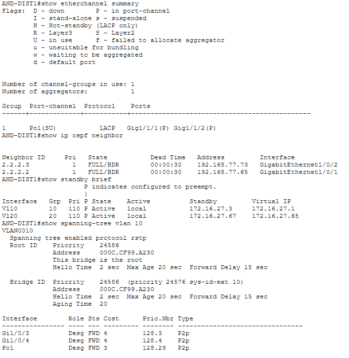

### Prueba de conmutación HSRP

Se ejecutó un `ping -t` continuo desde un PC de Ventas y se apagaron las SVIs de AND-DIST1 (`shutdown` en `interface vlan 10` y `vlan 20`). AND-DIST2 pasó a `Active`, se perdieron unos pocos paquetes y la conectividad se restableció en segundos. Al reactivar las SVIs, DIST1 recuperó el rol por el `preempt`.

- Antes

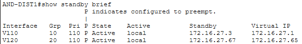

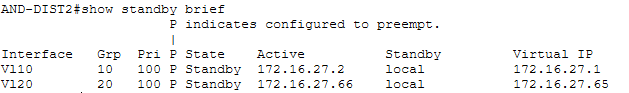

- Durante

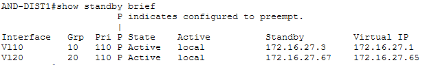

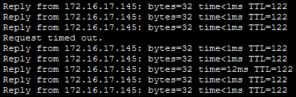

- Después

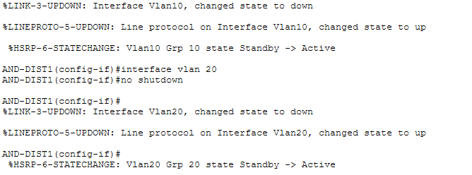

- La confirmación en DIST2

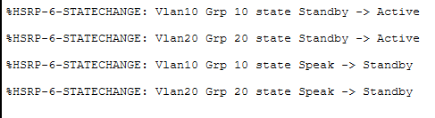

---

## ISP 3: MoonLink

- **Topología:** hub-and-spoke (MOON-R1 como hub y cuatro spokes).
- **IGP:** EIGRP AS 100 con `no auto-summary`.
- **Red inalámbrica:** WRT300N configurado como punto de acceso, en una subred propia.
- **Dispositivos:** MOON-CORE (switch multicapa 3650, borde BGP), 5 routers 2911 (R1 a R5), 5 switches 2960 y un WRT300N.

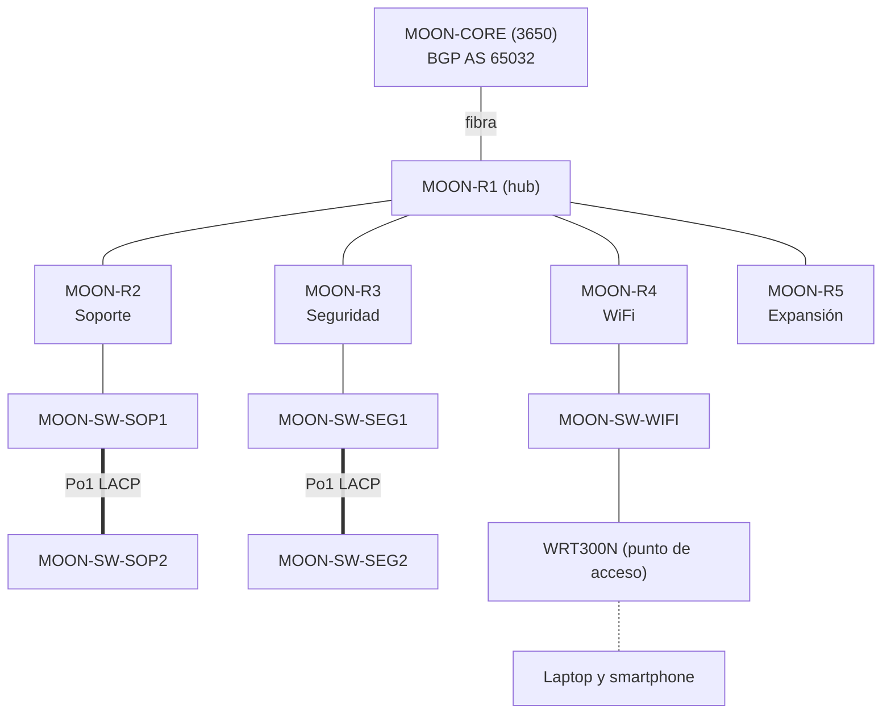

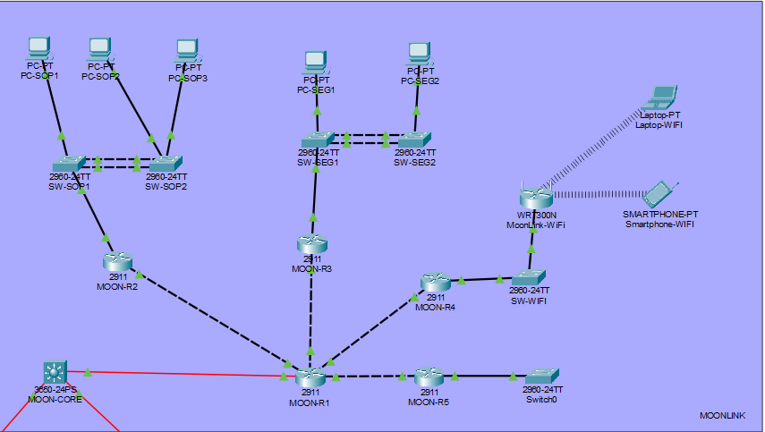

### Subneteo

Cada departamento debe soportar hasta 45 hosts, así que se usa un /26 (62 hosts útiles).

| Spoke | Departamento | Red | Gateway | Máscara |
| :---: | :---: | :---: | :---: | :---: |
| MOON-R2 | Soporte | 172.16.32.0/26 | 172.16.32.1 | 255.255.255.192 |
| MOON-R3 | Seguridad | 172.16.32.64/26 | 172.16.32.65 | 255.255.255.192 |
| MOON-R4 | WiFi (clientes) | 172.16.32.128/26 | 172.16.32.129 | 255.255.255.192 |
| MOON-R5 | Expansión (reservada, sin hosts) | 172.16.32.192/26 | 172.16.32.193 | 255.255.255.192 |

### Direccionamiento de enlaces

| Enlace | Medio | Red | Lado A | Lado B |
| :---: | :---: | :---: | :---: | :---: |
| MOON-CORE Gi1/1/3 ↔ MOON-R1 Gi0/0/0 | **Fibra** | 192.168.77.96/30 | .97 | .98 |
| MOON-R1 Gi0/0 ↔ MOON-R2 Gi0/0 | Cobre | 192.168.77.100/30 | .101 | .102 |
| MOON-R1 Gi0/1 ↔ MOON-R3 Gi0/0 | Cobre | 192.168.77.104/30 | .105 | .106 |
| MOON-R1 Gi0/2 ↔ MOON-R4 Gi0/0 | Cobre | 192.168.77.108/30 | .109 | .110 |
| MOON-R1 Fa0/1/0 (Vlan 1) ↔ MOON-R5 Gi0/0 | Cobre | 192.168.77.112/30 | .113 | .114 |

Router IDs:

- MOON-CORE 3.3.3.1

- MOON-R1 3.3.3.2

- MOON-R2 3.3.3.3

- MOON-R3 3.3.3.4

- MOON-R4 3.3.3.5

- MOON-R5 3.3.3.6.

### EtherChannels LACP

| Par de switches | Puertos | Grupo |
| :---: | :---: | :---: |
| MOON-SW-SOP1 ↔ MOON-SW-SOP2 | Fa0/23 y Fa0/24 en ambos | Po1 (LACP) |
| MOON-SW-SEG1 ↔ MOON-SW-SEG2 | Fa0/23 y Fa0/24 en ambos | Po1 (LACP) |

Los uplinks hacia el router usan `Gi0/1` de SW-SOP1, SW-SEG1 y SW-WIFI.

### Hosts

| Dispositivo | Ubicación | Departamento |
| :---: | :---: | :---: |
| PC-SOP1 | MOON-SW-SOP1 Fa0/1 | Soporte |
| PC-SOP2 | MOON-SW-SOP2 Fa0/1 | Soporte |
| PC-SOP3 | MOON-SW-SOP2 Fa0/2 | Soporte |
| PC-SEG1 | MOON-SW-SEG1 Fa0/1 | Seguridad |
| PC-SEG2 | MOON-SW-SEG2 Fa0/1 | Seguridad |
| Laptop-WIFI | Inalámbrico (WPC300N) | WiFi |
| Smartphone-WIFI | Inalámbrico | WiFi |

### Red inalámbrica

El WRT300N funciona como **punto de acceso** (no como router), conectado por un puerto LAN a `MOON-SW-WIFI`:

| Parámetro | Valor |
| :---: | :---: |
| Dirección IP del WRT300N | 172.16.32.130 / 255.255.255.192 |
| Servidor DHCP del WRT300N | **Deshabilitado** |
| SSID | `MoonLink-WiFi` |
| Seguridad | WPA2-Personal (clave:MoonLink-WiFi) |

Con el DHCP del WRT300N apagado, los clientes inalámbricos reciben IP del servidor DHCP central de AndinaCom (relay en MOON-R4), igual que el resto de la red.

- Configuración de MoonLink-WiFi:

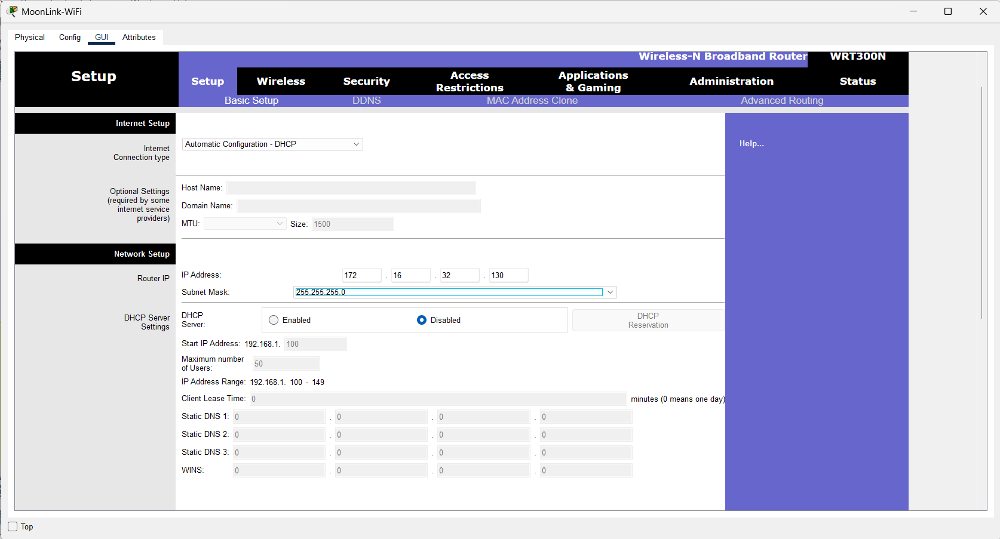

- Ip aprendida por DHCP de los hosts conectados a red inalámbrica

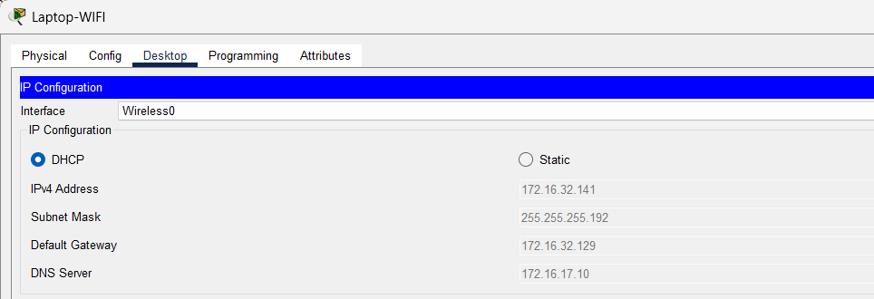

### Configuración

Para configurar el switch de capa 3 central, **MOON-CORE (3650, borde BGP)**

```cisco
enable
configure terminal
hostname MOON-CORE
no ip domain-lookup
ip routing
interface gigabitEthernet 1/1/1
 description FIBRA-BGP-ANDINACOM
 no switchport
 ip address 192.168.77.6 255.255.255.252
 no shutdown
interface gigabitEthernet 1/1/2
 description FIBRA-BGP-FIBRANET
 no switchport
 ip address 192.168.77.9 255.255.255.252
 no shutdown
interface gigabitEthernet 1/1/3
 description FIBRA-A-MOON-R1
 no switchport
 ip address 192.168.77.97 255.255.255.252
 no shutdown
ip route 172.16.32.0 255.255.255.0 null0
router eigrp 100
 eigrp router-id 3.3.3.1
 network 192.168.77.96 0.0.0.31
 redistribute bgp 65032 metric 100000 100 255 1 1500
 no auto-summary
router bgp 65032
 bgp router-id 3.3.3.1
 neighbor 192.168.77.5 remote-as 65027
 neighbor 192.168.77.10 remote-as 65017
 network 172.16.32.0 mask 255.255.255.0
end
write memory
```

El router que funciona como hub, **MOON-R1:**

```cisco
enable
configure terminal
hostname MOON-R1
no ip domain-lookup
interface gigabitEthernet 0/0/0
 description FIBRA-A-MOON-CORE
 ip address 192.168.77.98 255.255.255.252
 no shutdown
interface gigabitEthernet 0/0
 description A-MOON-R2
 ip address 192.168.77.101 255.255.255.252
 no shutdown
interface gigabitEthernet 0/1
 description A-MOON-R3
 ip address 192.168.77.105 255.255.255.252
 no shutdown
interface gigabitEthernet 0/2
 description A-MOON-R4
 ip address 192.168.77.109 255.255.255.252
 no shutdown
interface vlan 1
 description A-MOON-R5 (via Fa0/1/0)
 ip address 192.168.77.113 255.255.255.252
 no shutdown
router eigrp 100
 eigrp router-id 3.3.3.2
 network 192.168.77.96 0.0.0.31
 no auto-summary
end
write memory
```

El puerto `Fa0/1/0` pertenece al módulo de switch del 2911 y es de capa 2, así que no acepta dirección IP. La IP del enlace hacia R5 se asignó a la interfaz `Vlan 1` (SVI).

**Spokes con LAN (R2, R3 y R4):** misma plantilla, con estos valores:

| Router | Descripción LAN | Gi0/0 (hacia R1) | Gi0/1 (LAN) | `network` LAN | Router ID |
| :---: | :---: | :---: | :---: | :---: | :---: |
| MOON-R2 | LAN-SOPORTE | 192.168.77.102/30 | 172.16.32.1/26 | 172.16.32.0 0.0.0.63 | 3.3.3.3 |
| MOON-R3 | LAN-SEGURIDAD | 192.168.77.106/30 | 172.16.32.65/26 | 172.16.32.64 0.0.0.63 | 3.3.3.4 |
| MOON-R4 | LAN-WIFI | 192.168.77.110/30 | 172.16.32.129/26 | 172.16.32.128 0.0.0.63 | 3.3.3.5 |

```cisco
enable
configure terminal
hostname MOON-R2
no ip domain-lookup
interface gigabitEthernet 0/0
 description A-MOON-R1
 ip address 192.168.77.102 255.255.255.252
 no shutdown
interface gigabitEthernet 0/1
 description LAN-SOPORTE
 ip address 172.16.32.1 255.255.255.192
 ip helper-address 172.16.27.130
 no shutdown
router eigrp 100
 eigrp router-id 3.3.3.3
 network 192.168.77.96 0.0.0.31
 network 172.16.32.0 0.0.0.63
 passive-interface gigabitEthernet 0/1
 no auto-summary
end
write memory
```

El router que es configurado como futura expansión **MOON-R5:**

```cisco
enable
configure terminal
hostname MOON-R5
no ip domain-lookup
interface gigabitEthernet 0/0
 description A-MOON-R1
 ip address 192.168.77.114 255.255.255.252
 no shutdown
interface gigabitEthernet 0/1
 description LAN-EXPANSION-RESERVADA
 ip address 172.16.32.193 255.255.255.192
 no shutdown
router eigrp 100
 eigrp router-id 3.3.3.6
 network 192.168.77.96 0.0.0.31
 network 172.16.32.192 0.0.0.63
 passive-interface gigabitEthernet 0/1
 no auto-summary
end
write memory
```

**Switches de acceso (SOP1, SOP2, SEG1, SEG2):** mismo bloque que en FibraNet, cambiando el `hostname`. `MOON-SW-WIFI` solo lleva el hostname.

```cisco
enable
configure terminal
hostname MOON-SW-SOP1
no ip domain-lookup
interface range fastEthernet 0/23 - 24
 channel-protocol lacp
 channel-group 1 mode active
 no shutdown
end
write memory
```

Capturas de confirmación de configuraciones:

- MOON-R1:

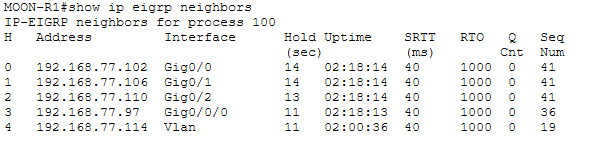

- EIGRP en MOON-CORE

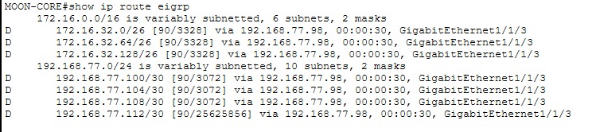

- Validando el EIGRP en MOON-R2

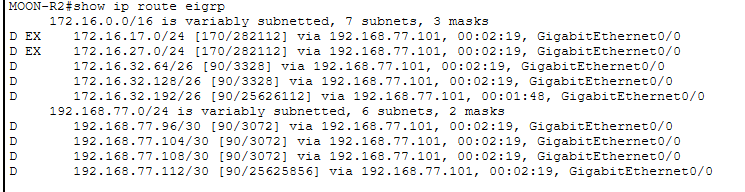

- Validación del `etherchannel` en SW-SOP1 y SW-SOP2

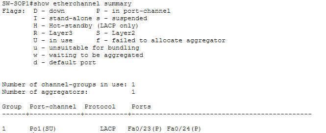


---

## Servicios centralizados

### DHCP (servidor en AndinaCom)

El servidor DHCP tiene IP estática (`172.16.27.130/27`). Todos los dispositivos finales obtienen IP por DHCP. Los gateways de los otros ISPs reenvían las solicitudes con `ip helper-address 172.16.27.130`.

| Pool | Gateway | DNS | IP inicial | Máscara |
| :---: | :---: | :---: | :---: | :---: |
| ventas | 172.16.27.1 | 172.16.17.10 | 172.16.27.10 | 255.255.255.192 |
| facturacion | 172.16.27.65 | 172.16.17.10 | 172.16.27.74 | 255.255.255.192 |
| administracion | 172.16.17.1 | 172.16.17.10 | 172.16.17.20 | 255.255.255.128 |
| atencion | 172.16.17.129 | 172.16.17.10 | 172.16.17.140 | 255.255.255.128 |
| soporte | 172.16.32.1 | 172.16.17.10 | 172.16.32.10 | 255.255.255.192 |
| seguridad | 172.16.32.65 | 172.16.17.10 | 172.16.32.74 | 255.255.255.192 |
| wifi | 172.16.32.129 | 172.16.17.10 | 172.16.32.140 | 255.255.255.192 |

En Ventas y Facturación el gateway es la **IP virtual de HSRP**, para que los hosts no pierdan salida cuando conmuta el gateway. Las IPs iniciales evitan los gateways y la `172.16.17.10` reservada al servidor DNS/HTTP.

Camino de una solicitud DHCP desde FibraNet: `PC → FNET-R4/R5 (relay) → R1 → FNET-CORE → BGP → AND-CORE1 → OSPF → AND-RSRV → servidor`.

-Pool del servidor DHCP

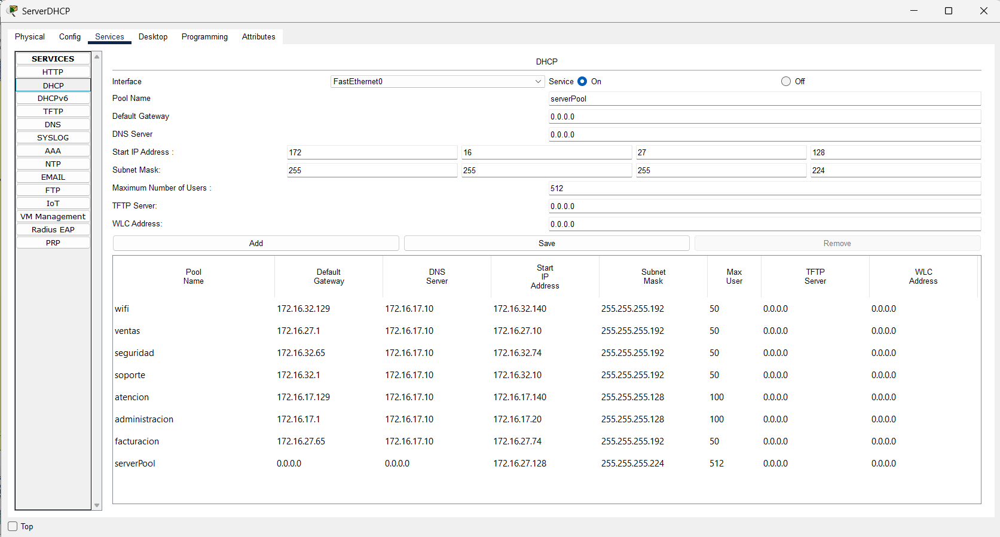

### DNS y HTTP/HTTPS (servidor en FibraNet)

| Parámetro | Valor |
| :---: | :---: |
| IP | 172.16.17.10 / 255.255.255.128 (estática) |
| Gateway | 172.16.17.1 |
| DNS | On, registro **A** `www.proyecto2_202004777.com` → `172.16.17.10` |
| HTTP y HTTPS | On, página `index.html` con los datos del estudiante e información básica del curso |

- Página por `http` y `https`

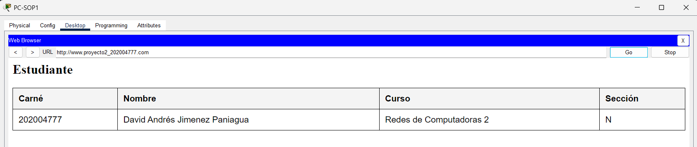

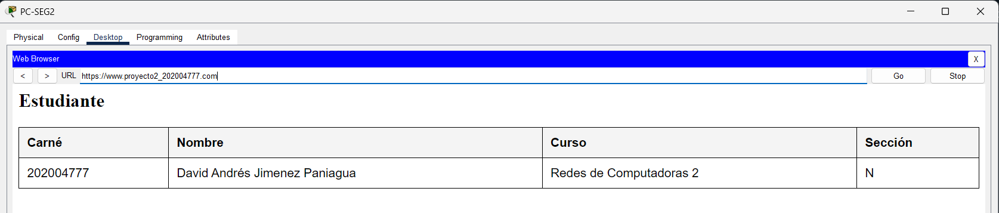

- nslookup www.proyecto2_202004777.com

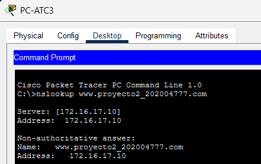

---

## Reglas de comunicación: ACLs

### Criterios de diseño

1. **Ubicación:** cada ACL se aplica en la interfaz LAN del gateway de su departamento, en sentido **entrante** (`in`). Así el tráfico no permitido se descarta lo más cerca posible del origen y no consume ancho de banda del resto de la red.
2. **Orden:** primero lo imprescindible para la red (DHCP, DNS y HSRP), luego los `deny` específicos y por último los `permit` generales. IOS evalúa de arriba hacia abajo y la primera coincidencia gana.
3. **Respuestas:** se usa `permit tcp ... established` para permitir las respuestas TCP de sesiones iniciadas desde fuera.
4. **Seguridad** es el único departamento protegido de entrada. Se logra con una ACL **saliente** en la interfaz LAN de su gateway, que solo deja pasar respuestas (`echo-reply`, `established`).
5. **HSRP:** las ACLs de las SVIs incluyen `permit udp any host 224.0.0.2 eq 1985`. Sin esa línea se bloquean los hellos y ambos DIST quedan en `Active`.
6. **DHCP y DNS:** la tabla del enunciado no los menciona, pero sin `UDP 67/68` y `UDP 53` los departamentos no recibirían IP ni resolverían el dominio.
7. **WiFi:** se interpreta como el departamento **Ventas** en la tabla de reglas.
8. **Seguridad vs. Soporte y Administración:** la tabla indica que Soporte y Administración son bidireccionales con cualquier departamento, y que cualquier departamento hacia Seguridad está bloqueado. Se tomó como decisión de diseño que **la restricción de Seguridad prevalece**.

### Dónde se aplica cada ACL

| Departamento | Dispositivo | Interfaz | Sentido | ACL |
| :---: | :---: | :---: | :---: | :---: |
| Ventas | AND-DIST1 y AND-DIST2 | Vlan 10 | `in` | ACL-VENTAS-IN |
| Facturación | AND-DIST1 y AND-DIST2 | Vlan 20 | `in` | ACL-FACTURACION-IN |
| Administración | FNET-R4 | Gi0/1 | `in` | ACL-ADMIN-IN |
| Atención al Cliente | FNET-R5 | Gi0/1 | `in` | ACL-ATENCION-IN |
| Soporte | MOON-R2 | Gi0/1 | `in` | ACL-SOPORTE-IN |
| Seguridad | MOON-R3 | Gi0/1 | `in` | ACL-SEG-IN |
| Seguridad | MOON-R3 | Gi0/1 | `out` | ACL-SEG-OUT |
| WiFi | MOON-R4 | Gi0/1 | `in` | ACL-WIFI-IN |

Se aplica en **los dos DIST** porque HSRP puede mover el rol de gateway de uno a otro.

### Resumen de reglas implementadas

| Origen | Destino | Permitido | Resultado esperado |
| :---: | :---: | :---: | :---: |
| Seguridad | Cualquier depto | ICMP, TCP/80, TCP/443 | Exitoso |
| Cualquier depto | Seguridad | – | Bloqueado |
| Soporte | Cualquier depto (excepto Seguridad) | ICMP, TCP/80, TCP/443 | Exitoso |
| Administración | Cualquier depto (excepto Seguridad) | ICMP, TCP/80, TCP/443 | Exitoso |
| Atención al Cliente | Ventas | ICMP, TCP/80 | Exitoso |
| Atención al Cliente | Facturación | – | Bloqueado |
| Facturación | Ventas | ICMP, TCP/80 | Exitoso |
| Facturación | Atención al Cliente | – | Bloqueado |
| Ventas | Facturación y Atención al Cliente | ICMP, TCP/80 | Exitoso |

### Código de las ACLs

Se configura en los routers **ACL-VENTAS-IN y ACL-FACTURACION-IN (AND-DIST1 y AND-DIST2)**

```cisco
ip access-list extended ACL-VENTAS-IN
 permit udp any eq 68 any eq 67
 permit udp any host 224.0.0.2 eq 1985
 permit udp 172.16.27.0 0.0.0.63 host 172.16.17.10 eq 53
 deny tcp 172.16.27.0 0.0.0.63 172.16.27.64 0.0.0.63 eq 443
 deny tcp 172.16.27.0 0.0.0.63 172.16.17.128 0.0.0.127 eq 443
 deny tcp 172.16.27.0 0.0.0.63 172.16.32.128 0.0.0.63 eq 443
 permit icmp 172.16.27.0 0.0.0.63 any
 permit tcp 172.16.27.0 0.0.0.63 any eq 80
 permit tcp 172.16.27.0 0.0.0.63 any eq 443
 permit tcp 172.16.27.0 0.0.0.63 any established
ip access-list extended ACL-FACTURACION-IN
 permit udp any eq 68 any eq 67
 permit udp any host 224.0.0.2 eq 1985
 permit udp 172.16.27.64 0.0.0.63 host 172.16.17.10 eq 53
 deny ip 172.16.27.64 0.0.0.63 172.16.17.128 0.0.0.127
 deny tcp 172.16.27.64 0.0.0.63 172.16.27.0 0.0.0.63 eq 443
 deny tcp 172.16.27.64 0.0.0.63 172.16.32.128 0.0.0.63 eq 443
 permit icmp 172.16.27.64 0.0.0.63 any
 permit tcp 172.16.27.64 0.0.0.63 any eq 80
 permit tcp 172.16.27.64 0.0.0.63 any eq 443
 permit tcp 172.16.27.64 0.0.0.63 any established
interface vlan 10
 ip access-group ACL-VENTAS-IN in
interface vlan 20
 ip access-group ACL-FACTURACION-IN in
```

Las reglas para FNET-R4 **ACL-ADMIN-IN**

```cisco
ip access-list extended ACL-ADMIN-IN
 permit udp any eq 68 any eq 67
 permit udp 172.16.17.0 0.0.0.127 host 172.16.17.10 eq 53
 permit udp host 172.16.17.10 eq 53 any
 permit icmp 172.16.17.0 0.0.0.127 any
 permit tcp 172.16.17.0 0.0.0.127 any eq 80
 permit tcp 172.16.17.0 0.0.0.127 any eq 443
 permit tcp 172.16.17.0 0.0.0.127 any established
interface gigabitEthernet 0/1
 ip access-group ACL-ADMIN-IN in
```

Las reglas para FNET-R5 **ACL-ATENCION-IN**

```cisco
ip access-list extended ACL-ATENCION-IN
 permit udp any eq 68 any eq 67
 permit udp 172.16.17.128 0.0.0.127 host 172.16.17.10 eq 53
 deny ip 172.16.17.128 0.0.0.127 172.16.27.64 0.0.0.63
 deny tcp 172.16.17.128 0.0.0.127 172.16.27.0 0.0.0.63 eq 443
 deny tcp 172.16.17.128 0.0.0.127 172.16.32.128 0.0.0.63 eq 443
 permit icmp 172.16.17.128 0.0.0.127 any
 permit tcp 172.16.17.128 0.0.0.127 any eq 80
 permit tcp 172.16.17.128 0.0.0.127 any eq 443
 permit tcp 172.16.17.128 0.0.0.127 any established
interface gigabitEthernet 0/1
 ip access-group ACL-ATENCION-IN in
```

Las reglas para MOON-R2 **ACL-SOPORTE-IN**

```cisco
ip access-list extended ACL-SOPORTE-IN
 permit udp any eq 68 any eq 67
 permit udp 172.16.32.0 0.0.0.63 host 172.16.17.10 eq 53
 permit icmp 172.16.32.0 0.0.0.63 any
 permit tcp 172.16.32.0 0.0.0.63 any eq 80
 permit tcp 172.16.32.0 0.0.0.63 any eq 443
 permit tcp 172.16.32.0 0.0.0.63 any established
interface gigabitEthernet 0/1
 ip access-group ACL-SOPORTE-IN in
```

Las reglas para MOON-R3 **ACL-SEG-IN y ACL-SEG-OUT**

```cisco
ip access-list extended ACL-SEG-OUT
 permit icmp any 172.16.32.64 0.0.0.63 echo-reply
 permit tcp any 172.16.32.64 0.0.0.63 established
 permit udp host 172.16.17.10 eq 53 172.16.32.64 0.0.0.63
ip access-list extended ACL-SEG-IN
 permit udp any eq 68 any eq 67
 permit udp 172.16.32.64 0.0.0.63 host 172.16.17.10 eq 53
 permit icmp 172.16.32.64 0.0.0.63 any
 permit tcp 172.16.32.64 0.0.0.63 any eq 80
 permit tcp 172.16.32.64 0.0.0.63 any eq 443
 permit tcp 172.16.32.64 0.0.0.63 any established
interface gigabitEthernet 0/1
 ip access-group ACL-SEG-IN in
 ip access-group ACL-SEG-OUT out
```

Las reglas para MOON-R4**ACL-WIFI-IN**

```cisco
ip access-list extended ACL-WIFI-IN
 permit udp any eq 68 any eq 67
 permit udp 172.16.32.128 0.0.0.63 host 172.16.17.10 eq 53
 deny tcp 172.16.32.128 0.0.0.63 172.16.27.0 0.0.0.63 eq 443
 deny tcp 172.16.32.128 0.0.0.63 172.16.27.64 0.0.0.63 eq 443
 deny tcp 172.16.32.128 0.0.0.63 172.16.17.128 0.0.0.127 eq 443
 permit icmp 172.16.32.128 0.0.0.63 any
 permit tcp 172.16.32.128 0.0.0.63 any eq 80
 permit tcp 172.16.32.128 0.0.0.63 any eq 443
 permit tcp 172.16.32.128 0.0.0.63 any established
interface gigabitEthernet 0/1
 ip access-group ACL-WIFI-IN in
```

### Nota sobre las pruebas de TCP/443

Solo existe un servidor web (en Administración), por lo que los bloqueos de TCP/443 entre Ventas, Atención al Cliente y WiFi no se pueden demostrar con tráfico real. Se verifican con las listas de acceso (`show access-lists`).

- Se agrega un ejempli de validación de aplicación correcta en `FNET-R5`

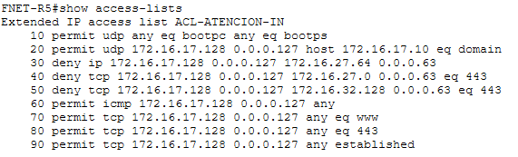

---

## Pruebas y verificación

### Estado de los protocolos

| Prueba | Dispositivo | Resultado |
| :---: | :---: | :---: |
| BGP | FNET-CORE, AND-CORE1, MOON-CORE | 2 vecinos en `Established` cada uno; cada CORE aprende los `/24` de los otros dos ISPs |
| OSPF | AND-CORE1 | 3 vecinos en FULL (CORE2, DIST1, DIST2) |
| OSPF | FNET-R1 | 3 vecinos en FULL (CORE, R2, R3) |
| EIGRP | MOON-R1 | 5 vecinos (CORE, R2, R3, R4, R5) |
| HSRP | AND-DIST1 / AND-DIST2 | DIST1 `Active`, DIST2 `Standby` en los grupos 10 y 20 |
| STP | AND-DIST1 | Root bridge de las VLAN 10 y 20 |
| LACP | Todos los EtherChannels | Port-channels en `(SU)` o `(RU)` con puertos en `(P)` |
| DHCP | Todos los hosts | IP, máscara, gateway y DNS del pool correspondiente |

### Matriz de pruebas de comunicación

Pruebas realizadas desde los PCs con `ping -n 6`. El primer paquete puede perderse por ARP.

| Origen | Destino | Esperado | Evidencia |
| :---: | :---: | :---: | :---: |
| Facturación | Ventas | Exitoso | `docs/img/8.png` |
| Atención al Cliente | Ventas | Exitoso | `docs/img/10.png` |
| Seguridad | Ventas | Exitoso | `docs/img/11.png` |
| Soporte | Ventas | Exitoso | `docs/img/12.png` |
| Facturación | Seguridad | Bloqueado | `docs/img/14.png` |
| Ventas | Seguridad | Bloqueado | `docs/img/15.png` |
| Atención al Cliente | Seguridad | Bloqueado | `docs/img/16.png` |
| Soporte | Seguridad | Bloqueado | `docs/img/17.png` |
| Administración | Seguridad | Bloqueado | `docs/img/18.png` |
| WiFi | Seguridad | Bloqueado | `docs/img/19.png` |
| Atención al Cliente | Facturación | Bloqueado | `docs/img/21.png` |
| Ventas | Facturación | Exitoso | `docs/img/22.png` |
| Administración | Facturación | Exitoso | `docs/img/23.png` |
| Facturación | Atención al Cliente | Bloqueado | `docs/img/24.png` |

### Rourters

Se verifica que en cada router en que se aplicaron las reglas ACLs:

- Router 5 de FibreaNet


### Ping

Para los siguientes pings se utiliza la ip de ventas `172.16.27.12`:

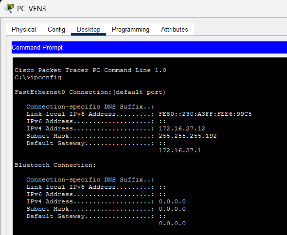

- De Facturación a Ventas

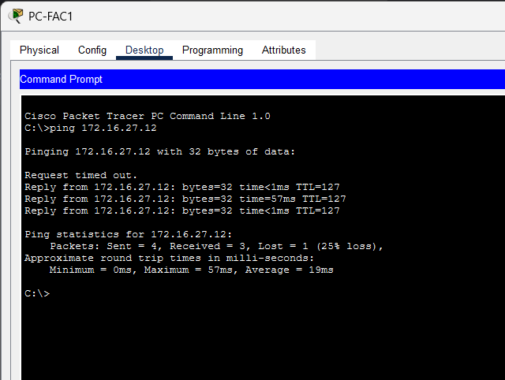

- De Atención al Cliente a Ventas

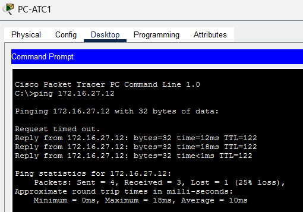

- De Seguridad a ventas

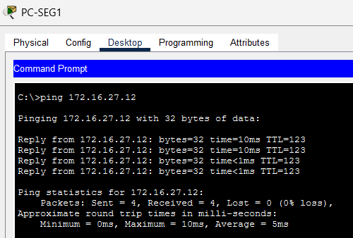

- De Soporte a Ventas

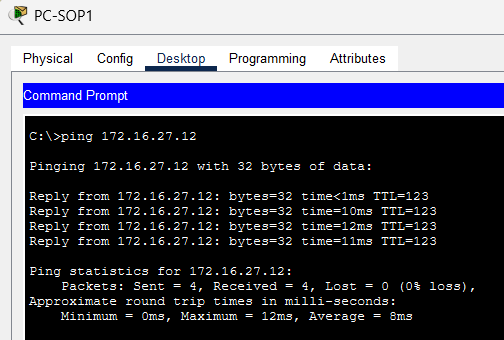

Los siguientes pings son hacia seguridad, se utiliza la ip `172.16.32.75`

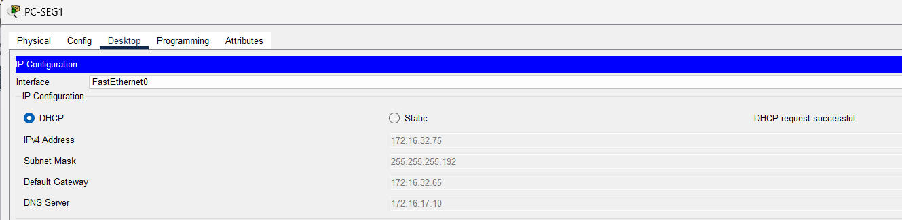

- De Ventas a Seguridad

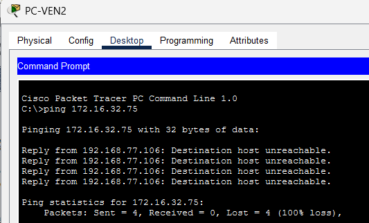

- De Facturación a Seguridad

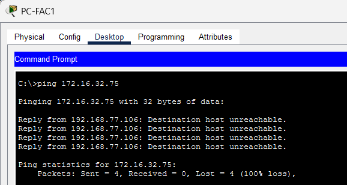

- De Ventas a Seguridad


- De Atención al cliente a Seguridad

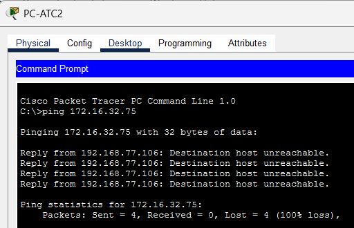

- De Soporte a Seguridad

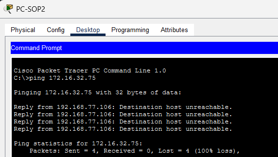

- De Administración a Seguridad

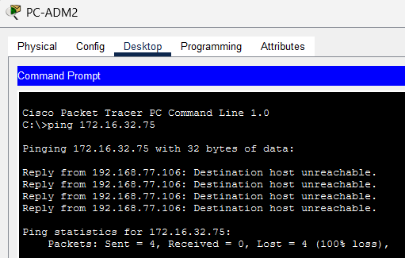

- De Wifi a Seguridad

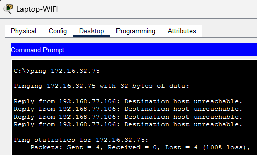

Se validará que Atención al cliente y Ventas puedan acceder a Facturación, con IP `172.16.27.75`

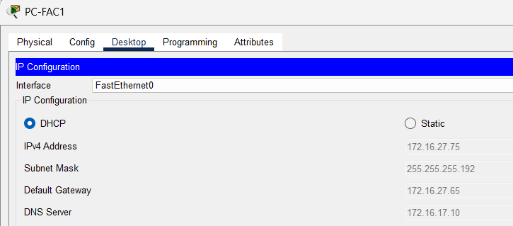

- De Atención al cliente a Facturación

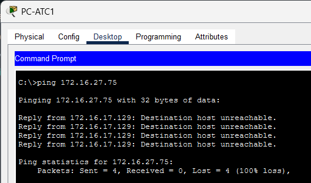

- De Ventas a Facturación


- De Administración a Facturación

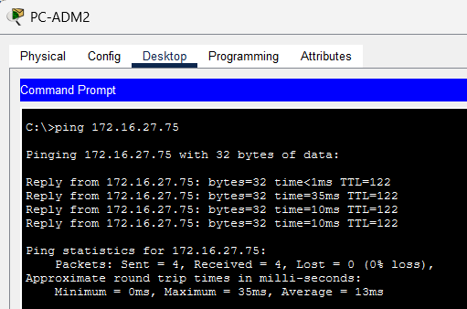

- De Facturación a Atención al Cliente (ip `172.16.17.140`)

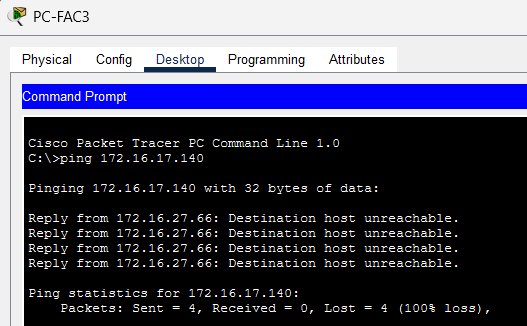

---

## Decisiones de diseño y limitaciones del simulador

### Decisiones de diseño

| # | Decisión | Justificación |
| :---: | :---: | :---: |
| 1 | **Arquitectura de medios por capas:** fibra en el core, en los enlaces entre ISPs y en los EtherChannels de AndinaCom; cobre en acceso | Se concentra el tráfico agregado donde conviene (ancho de banda, distancia, inmunidad a interferencias) y se controla el costo en acceso. El enunciado exige fibra entre routers. |
| 2 | Transceptor **GLC-LH-SMD** (1000BASE-LX/LH, monomodo, hasta 10 km) | Es el SFP disponible en Packet Tracer. |
| 3 | Un solo área OSPF (0) | Las topologías son pequeñas y no justifican múltiples áreas. |
| 4 | Ruta estática a `Null0` por ISP | Permite anunciar el `/24` completo por BGP. |
| 5 | Redistribución de BGP hacia el IGP | El 3650 de Packet Tracer no acepta `default-information originate`. |
| 6 | VLANs solo en AndinaCom | Allí los dos departamentos comparten los switches de acceso. En FibraNet y MoonLink cada departamento cuelga de la interfaz de un router distinto, que ya es su propio dominio de broadcast. |
| 7 | Gateway DHCP = IP virtual HSRP | Los hosts no pierden salida cuando conmuta el gateway. |
| 8 | Servidor DHCP en una subred propia detrás de un router | Aísla los servicios de los departamentos. Los servidores pueden tener IP estática. |
| 9 | LACP en puertos Fast Ethernet y uplink al router en `Gi0/1` | La salida del departamento no se convierte en cuello de botella. |
| 10 | WRT300N como punto de acceso con DHCP desactivado | Los clientes WiFi usan el DHCP central y las ACLs se aplican en una sola interfaz. |
| 11 | MOON-R5 con una LAN reservada y sin hosts | Completa los 5 routers del ISP y deja espacio de crecimiento. |
| 12 | AND-RSRV2 y AND-RBKP con doble enlace a CORE1 y CORE2 | Aportan rutas alternativas en el núcleo y routers dedicados a servicios y respaldo. |
| 13 | STP Rapid-PVST con DIST1 como root | Convergencia rápida y alineación del root con el HSRP activo. |

### Limitaciones del simulador

| Situación | Efecto | Solución aplicada |
| :---: | :---: | :---: |
| `default-information originate` no soportado en el 3650 | R4 y R5 de FibraNet no tenían ruta hacia los otros ISPs | Redistribuir BGP en OSPF |
| `Fa0/1/0` del módulo de switch del 2911 no admite `ip address` | EIGRP no formaba vecindad con MOON-R5 | Asignar la IP a la `Vlan 1` |
| `ping <ip> source <ip>` no soportado en el 2911 | No se podía probar con origen en la LAN | Pruebas desde los hosts |
| Estado atascado de STP/HSRP tras cablear el Po1 | Ambos DIST aparecían como `Active` | Reinicio del Po1 |
| El ping simple desde un router usa la IP del enlace `/30`, que no se anuncia por BGP | Falla aunque el ISP funcione | La conectividad se valida desde los hosts |
| El cliente DHCP de Packet Tracer a veces falla en el primer intento | `DHCP request failed` | Repetir la solicitud |

---

### Análisis de Wireshark

Disponible en [Análisis.md](./Wireshark/Análisis.md)
