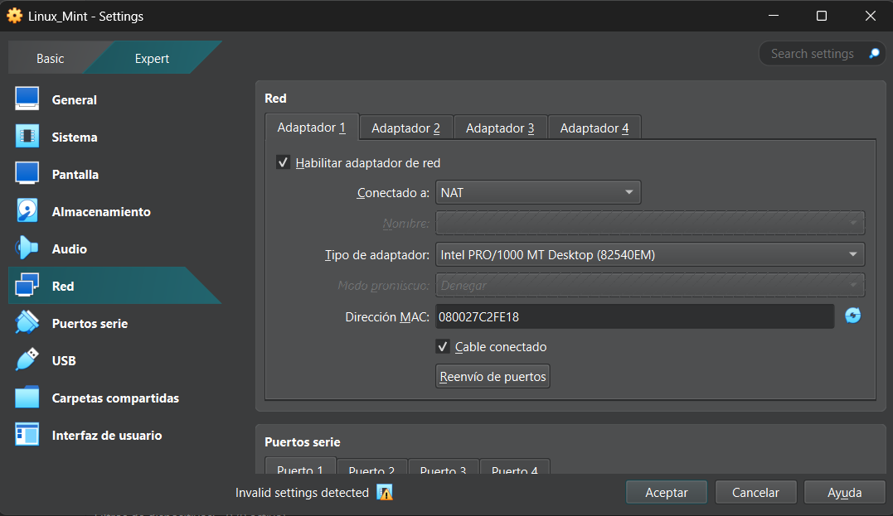
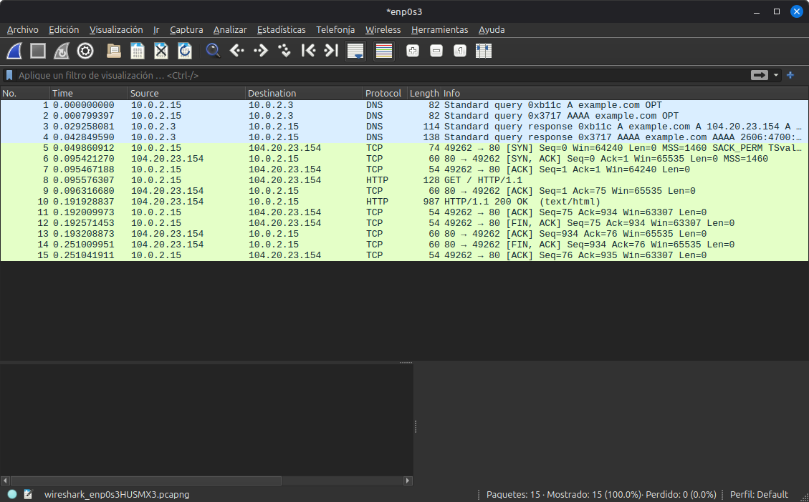
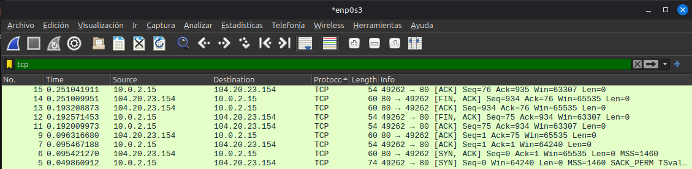
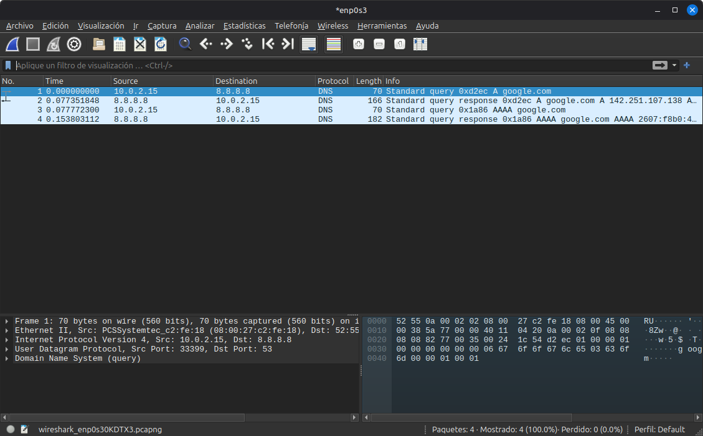
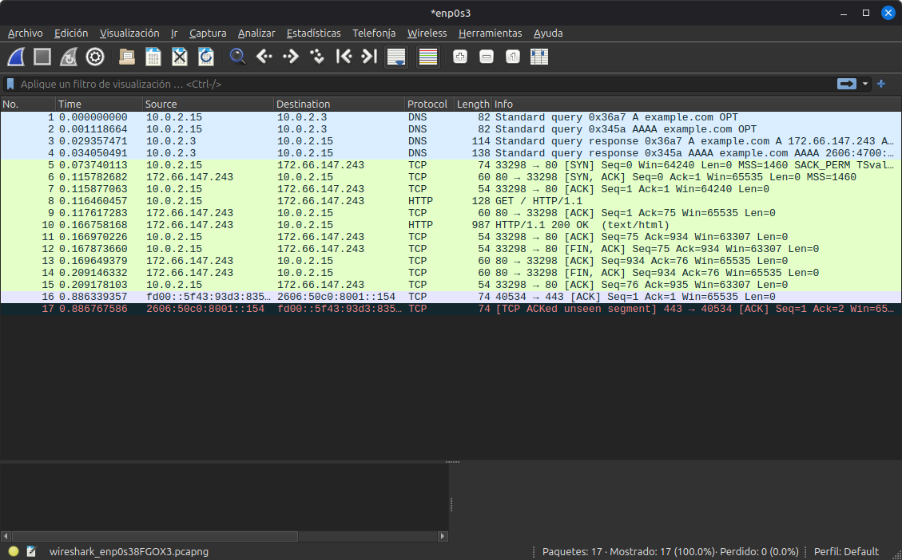
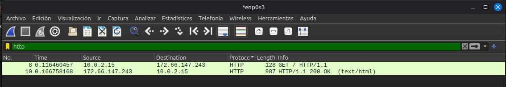
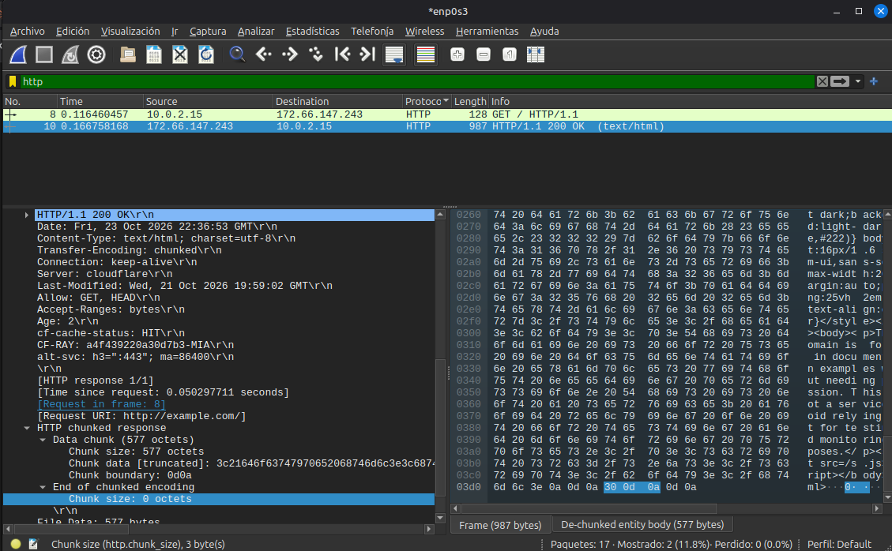
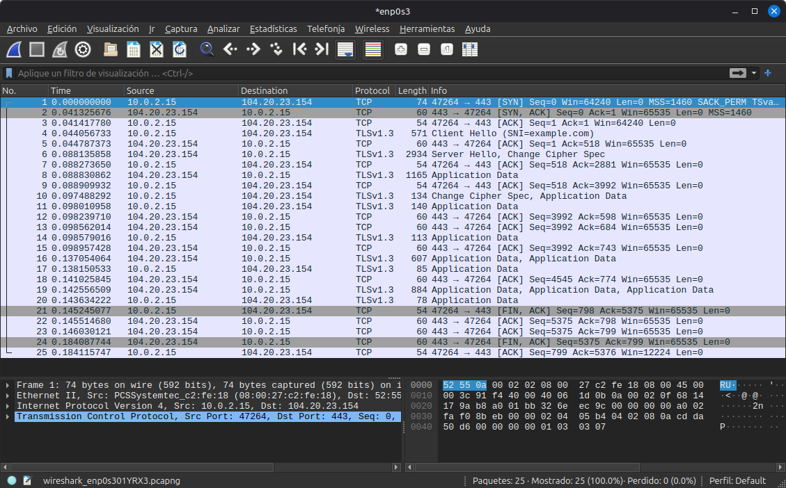
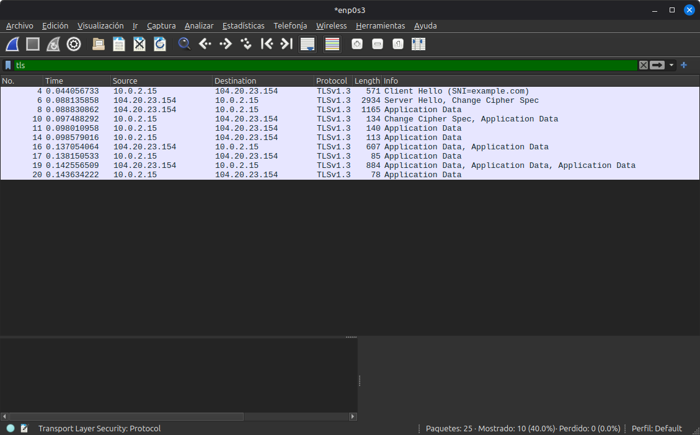
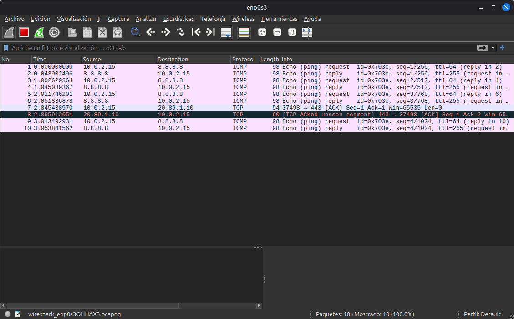

# Análisis de tráfico con Wireshark

**Curso:** Redes de Computadoras 2 - Proyecto 2 - Segundo Semestre 2026
**Estudiante:** David Andrés Jimenez Paniagua
**Carné:** 202004777
**Archivo de captura:** `Proyecto_2/Wireshark/captura_wireshark_#carné.pcapng`

---

## Entorno de captura

| Elemento | Valor |
|---|---|
| Máquina virtual | Linux Mint sobre VirtualBox |
| Modo de red | NAT (cable conectado) |
| Interfaz capturada | `enp0s3` |
| IP de la VM | `10.0.2.15` |
| Gateway virtual (VirtualBox NAT) | `10.0.2.2` (MAC destino de las tramas: `52:55:0a:00:02:02`) |
| DNS virtual (VirtualBox NAT) | `10.0.2.3` |
| MAC de la VM | `08:00:27:c2:fe:18` (prefijo `08:00:27` = VirtualBox) |
| Herramientas de tráfico | `curl`, `nslookup`, `ping` |

Como la VM está en NAT, todo el tráfico capturado es generado por la VM y no por el equipo anfitrión.

### Mapa de la captura

El archivo contiene los cuatro escenarios, ejecutados uno tras otro:

| Escenario | Frames | Comando | Filtro útil |
|---|---|---|---|
| Handshake TCP + HTTPS (primera ejecución) | 1 - 31 | `curl https://example.com` | `tcp.port == 52008` |
| **HTTP** (TCP handshake + GET) | 126 - 136 | `curl http://example.com` | `tcp.port == 37100` |
| **HTTPS** (segunda ejecución) | 137 - 161 | `curl https://example.com` | `tcp.port == 47734` |
| **DNS** contra servidor público | 120 - 123 | `nslookup google.com 8.8.8.8` | `dns && ip.addr == 8.8.8.8` |
| **ICMP** | 162 – 169 | `ping -c 4 8.8.8.8` | `icmp` |

> **Tráfico de fondo.** El archivo también contiene tráfico propio del sistema que **no forma parte** del análisis: QUIC hacia `160.79.104.10` (frames 32–103), la consulta HTTP de `connectivity-check.ubuntu.com` (frames 104–115), ICMPv6 (116–119) y un ACK suelto hacia `20.89.1.10` (124–125). Se ignoran filtrando por los puertos o IPs de cada escenario.

---

## Escenario 1: TCP three-way handshake

**Comando:** `curl http://example.com`
**Conexión analizada:** frames 126–128 (`10.0.2.15:37100` → `172.66.147.243:80`)
**Filtro:** `tcp.flags.syn == 1 || tcp.port == 37100`

### Los tres segmentos

| Frame | Tiempo (s) | Origen → Destino | Flags | Seq | Ack | Win | Opciones / notas |
|---|---|---|---|---|---|---|---|
| 126 | 18.362343 | `10.0.2.15:37100` → `172.66.147.243:80` | **SYN** | 0 | 0 | 64240 | MSS=1460, SACK_PERM, TSval, WS=128 |
| 127 | 18.404133 | `172.66.147.243:80` → `10.0.2.15:37100` | **SYN, ACK** | 0 | 1 | 65535 | MSS=1460 |
| 128 | 18.404283 | `10.0.2.15:37100` → `172.66.147.243:80` | **ACK** | 1 | 1 | 64240 | — |

> Wireshark muestra números de secuencia **relativos** (por eso el SYN aparece con `Seq=0`). El número real (ISN) es un valor aleatorio de 32 bits. Por ejemplo, en otra de las capturas el SYN hacia `104.20.23.154:443` llevaba el ISN absoluto `846130332` (`0x326eec9c`).

### Análisis capa por capa (frame SYN)

Los valores salen del volcado hexadecimal del primer paquete de la captura HTTPS (puerto origen 47264), porque es el que quedó en pantalla con el detalle completo.

| Capa | Campo | Valor |
|---|---|---|
| **2 - Ethernet II** | MAC origen / destino | `08:00:27:c2:fe:18` → `52:55:0a:00:02:02` (gateway NAT) |
| | EtherType | `0x0800` (IPv4) |
| **3 - IPv4** | Origen / Destino | `10.0.2.15` → `104.20.23.154` |
| | Longitud total / TTL | 60 bytes / 64 |
| | Flags | DF (Don't Fragment) |
| | Protocolo | 6 (TCP) |
| **4 - TCP** | Puertos | origen efímero `47264`, destino `443` |
| | Longitud de cabecera | 40 bytes (20 + 20 de opciones) |
| | Flags | SYN |
| | Window | 64240 |
| | Opciones | MSS 1460, SACK permitido, Timestamps, NOP, Window Scale 7 (×128) |
| **7 - Aplicación** | — | Sin datos (segmento de control) |

### Explicación

1. **SYN.** El cliente solicita abrir la conexión y propone su número de secuencia inicial. También anuncia sus capacidades (MSS, SACK, escalado de ventana).
2. **SYN-ACK.** El servidor acepta y propone su propio número de secuencia. Su `Ack=1` confirma el SYN del cliente, porque el SYN consume un número de secuencia.
3. **ACK.** El cliente confirma el SYN del servidor y la conexión queda establecida. A partir de aquí (`Seq=1`, `Ack=1`) puede enviar datos.

Tiempo entre SYN y SYN-ACK: **≈ 41.8 ms** (RTT hacia el servidor). El handshake completo toma **≈ 41.9 ms**.

> El SYN-ACK solo incluye la opción MSS, sin timestamps ni escalado de ventana. Es consistente con que quien responde en nombre del servidor es el motor NAT de VirtualBox.

---

## Escenario 2: Resolución DNS

**Comando:** `nslookup google.com 8.8.8.8`
**Frames en el archivo final:** 120–123
**Filtro:** `dns`

### Intercambio

| Frame | Tiempo (s) | Sentido | Tipo | Transaction ID | Resultado |
|---|---|---|---|---|---|
| 120 | 11.308398 | `10.0.2.15` → `8.8.8.8` | Consulta **A** `google.com` | `0x212d` | — |
| 121 | 11.361015 | `8.8.8.8` → `10.0.2.15` | Respuesta | `0x212d` | `A 142.251.215.110` |
| 122 | 11.362541 | `10.0.2.15` → `8.8.8.8` | Consulta **AAAA** `google.com` | `0x2f4e` | — |
| 123 | 11.414221 | `8.8.8.8` → `10.0.2.15` | Respuesta | `0x2f4e` | `AAAA 2607:f8b0:4008:80c::200e` |

`nslookup` envía una consulta A (IPv4) y otra AAAA (IPv6). Tiempo de respuesta: **≈ 52.6 ms** (A) y **≈ 51.7 ms** (AAAA).

### Análisis capa por cap

| Capa | Campo | Valor |
|---|---|---|
| **2 - Ethernet II** | MAC origen / destino | `08:00:27:c2:fe:18` → `52:55:0a:00:02:02` |
| **3 - IPv4** | Origen / Destino | `10.0.2.15` → `8.8.8.8` |
| | Longitud total / TTL | 56 bytes / 64 |
| | Protocolo | 17 (**UDP**) |
| **4 - UDP** | Puerto origen | efímero (`33399` en la captura de pantalla) |
| | Puerto destino | **53** (DNS) |
| | Longitud | 36 bytes (8 de cabecera + 28 de DNS) |
| **7 - DNS** | Transaction ID | `0xd2ec` en la captura de pantalla (`0x212d` en el archivo final) |
| | Flags | `0x0100`: consulta estándar, recursión deseada |
| | Pregunta | `google.com`, tipo **A** (1), clase IN (1) |
| | Respuestas | 0 |

**Respuesta (frame 121, 86 bytes):** UDP con los puertos invertidos (origen 53, destino el puerto efímero). Mismo Transaction ID, que es lo que permite emparejar consulta y respuesta. Incluye 1 registro en la sección Answers (16 bytes): nombre, tipo **A**, clase IN, **TTL**, longitud 4 y la dirección `142.251.215.110`.

- **Tipo de registro:** A (IPv4) y AAAA (IPv6).
- **TTL del registro:** **151** segundos. Es el tiempo máximo que un resolver o cliente puede guardar la respuesta en caché antes de volver a consultar.
- **Transporte:** UDP/53, sin handshake. DNS usa UDP por ser consultas pequeñas de un solo intercambio.

### Observación: DNS por `10.0.2.3`

Cuando `curl` resuelve `example.com` (frames 1-4), consulta a `10.0.2.3`, el DNS virtual de VirtualBox, y no a `8.8.8.8`. Esas consultas llevan el pseudo-registro **OPT** (EDNS0, 82 bytes), mientras que las de `nslookup` a `8.8.8.8` no (70 bytes). La respuesta devolvió dos direcciones A (`172.66.147.243` y `104.20.23.154`), ambas de la red de Cloudflare.

---

## Escenario 3: HTTP vs HTTPS

### HTTP (texto plano)

**Comando:** `curl http://example.com` · **Frames:** 126-136 · **Filtro:** `http`

| Frame | Tiempo (s) | Descripción |
|---|---|---|
| 129 | 18.404718 | `GET / HTTP/1.1`: frame de 128 bytes, 74 bytes de payload TCP |
| 130 | 18.405694 | ACK del servidor (`Ack=75`) |
| 131 | 18.459671 | `HTTP/1.1 200 OK (text/html)`: frame de 987 bytes, 933 bytes de payload |
| 132 | 18.459808 | ACK del cliente (`Ack=934`) |
| 133–136 | 18.4601 – 18.5050 | Cierre de la conexión (FIN/ACK en ambos sentidos) |

El **tiempo de respuesta HTTP** (GET → 200 OK) es de **≈ 55 ms**.

**Contenido visible en claro (detalle del frame 131):**

- Línea de estado: `HTTP/1.1 200 OK`
- `Content-Type: text/html; charset=utf-8`
- `Transfer-Encoding: chunked`: el cuerpo viaja en fragmentos (chunk de 577 octetos y chunk final de 0 octetos)
- `Server: cloudflare`, `cf-cache-status: HIT`, `Age`, `Date`, `Last-Modified`
- El **HTML completo** es legible en el panel de bytes (se lee el texto *"This domain is for use in documentation examples..."*)

**Capas:** Ethernet → IPv4 (protocolo 6) → TCP (puerto destino **80**, flags PSH/ACK en los datos) → **HTTP** (aplicación, sin cifrar).

### HTTPS (HTTP sobre TLS 1.3)

**Comando:** `curl https://example.com` - **Frames:** 137-161 - **Filtro:** `tls`

**Secuencia (conexión `10.0.2.15:47734` → `104.20.23.154:443`):**

| Frame | Tiempo (s) | Mensaje | Tamaño | Qué ocurre |
|---|---|---|---|---|
| 137–139 | 25.3283 – 25.3688 | SYN / SYN-ACK / ACK | 74 / 60 / 54 | Handshake TCP al puerto **443** |
| 140 | 25.371252 | **Client Hello** (SNI=`example.com`) | 571 | El cliente propone versiones TLS, cipher suites y claves; el **SNI viaja en claro** |
| 142 | 25.412781 | **Server Hello, Change Cipher Spec** | 2934 | El servidor elige parámetros y su clave; a partir de aquí el resto va cifrado |
| 144 | 25.413707 | Application Data | 1164 | En TLS 1.3 aquí viajan, **cifrados**, EncryptedExtensions, Certificate, CertificateVerify y Finished |
| 146 | 25.416757 | Change Cipher Spec, Application Data | 134 | `Finished` del cliente (el CCS es solo de compatibilidad) |
| 147–156 | 25.4173 – 25.4688 | Application Data | 78 – 885 | Petición HTTP, respuesta y tickets de sesión, **todo cifrado** |
| 158–161 | 25.4713 – 25.5116 | FIN/ACK ×2 | 54 / 60 | Cierre de la conexión TCP |

- **Versión negociada:** TLS 1.3.
- **Cipher suite elegida:** **tls.handshake.ciphersuite 0x1302**.
- **Handshake TLS:** desde el Client Hello (25.371) hasta el Finished del cliente (25.417) ≈ **45 ms**, equivalente a 1 RTT.

> Por eso en Wireshark **no aparece la etiqueta "HTTP"** en el tráfico HTTPS. Wireshark solo etiqueta lo que puede decodificar, y el HTTP viaja dentro del payload cifrado de TLS. Se ve **TCP + TLSv1.3**.

### ¿Por qué el contenido aparece cifrado?

1. En el handshake (Client Hello / Server Hello) cliente y servidor intercambian parámetros de clave pública (en TLS 1.3, ECDHE) y derivan **claves simétricas de sesión** que nunca viajan por la red.
2. Desde el Server Hello, todos los mensajes del handshake y los datos de aplicación se cifran con esas claves (algoritmo AEAD, p. ej. AES-GCM).
3. Un observador en la red solo ve metadatos: IPs, puertos, tamaños, tiempos y el **SNI**. No ve método, ruta, cabeceras ni cuerpo. Solo ve registros genéricos `Application Data`.

### Comparación

| Aspecto | HTTP | HTTPS |
|---|---|---|
| Puerto destino | 80 | 443 |
| Protocolo visible | TCP + **HTTP** | TCP + **TLSv1.3** |
| Mensajes de aplicación | `GET`, `200 OK`, cabeceras | `Application Data` (ilegible) |
| Contenido HTML | Legible en la captura | No legible sin las claves |
| Mensajes extra | Ninguno | Client Hello, Server Hello, Finished |
| Qué ve un intruso | Todo el contenido | Solo metadatos (IP, puertos, SNI, tamaños) |
| Paquetes de la conexión | 11 (frames 126–136) | 25 (frames 137–161) |
| Seguridad | Sin confidencialidad ni integridad | Cifrado, integridad y autenticación del servidor |

---

## Escenario 4: ICMP

**Comando:** `ping -c 4 8.8.8.8` 
**Frames:** 162–169
**Filtro:** `icmp`

| Seq | Request (frame / t) | Reply (frame / t) | RTT | TTL request | TTL reply |
|---|---|---|---|---|---|
| 1 | 162 / 31.827524 | 163 / 31.870986 | 43.46 ms | 64 | 255 |
| 2 | 164 / 32.831693 | 165 / 32.875493 | 43.80 ms | 64 | 255 |
| 3 | 166 / 33.832462 | 167 / 33.874368 | 41.91 ms | 64 | 255 |
| 4 | 168 / 34.834022 | 169 / 34.874255 | 40.23 ms | 64 | 255 |

**RTT promedio ≈ 42.35 ms** (mín. 40.23 ms, máx. 43.80 ms). Los paquetes salen con **≈ 1 s** de separación, que es el intervalo por defecto de `ping`.

### Análisis capa por capa

| Capa | Campo | Echo Request | Echo Reply |
|---|---|---|---|
| **2 – Ethernet II** | MAC | VM → gateway NAT | gateway NAT → VM |
| **3 – IPv4** | Origen → Destino | `10.0.2.15` → `8.8.8.8` | `8.8.8.8` → `10.0.2.15` |
| | Protocolo | 1 (ICMP) | 1 (ICMP) |
| | TTL | 64 (valor inicial de Linux) | 255 |
| | Tamaño del frame | 98 bytes (14 + 20 + 64) | 98 bytes |
| **4 – (no hay)** | — | ICMP viaja **directo sobre IP**, sin TCP ni UDP | |
| **ICMP** | Tipo / Código | **8** / 0 | **0** / 0 |
| | Identifier | `0x708c` | `0x708c` (igual) |
| | Sequence number | 1, 2, 3, 4 | igual al del request |
| | Datos | 56 bytes de payload | eco de los mismos datos |

### Explicación

- **Echo Request (tipo 8)** lo envía la VM y **Echo Reply (tipo 0)** lo devuelve el destino. Wireshark los empareja con el *Identifier* (identifica el proceso `ping`) y el *Sequence Number* (identifica cada intento). Además lo indica en la columna Info (`reply in 163` / `request in 162`).
- Wireshark muestra `seq=1/256` porque el número está en orden de red (big endian, `0x0001`) y entre paréntesis lo muestra interpretado como little endian (`0x0100` = 256).
- **El TTL de las respuestas es 255**, y no el ~110–120 esperable de un host real a varios saltos. Esto es consecuencia del modo NAT de VirtualBox: el motor NAT atiende el ping por la VM y genera la respuesta él mismo, así que el TTL no refleja la distancia real hasta `8.8.8.8`.
- 4 enviados, 4 recibidos: **0 % de pérdida**.

---

## Resumen de protocolos analizados

| Protocolo | Capa (OSI) | Transporte | Puerto | Escenario |
|---|---|---|---|---|
| Ethernet II | 2 | — | — | Todos |
| IPv4 | 3 | — | — | Todos |
| ICMP | 3 | Directo sobre IP | — | 4 |
| TCP | 4 | — | 80 / 443 | 1, 3 |
| UDP | 4 | — | 53 | 2 |
| DNS | 7 | UDP | 53 | 2 |
| HTTP | 7 | TCP | 80 | 3 |
| TLS 1.3 (HTTPS) | 5–7 | TCP | 443 | 3 |
